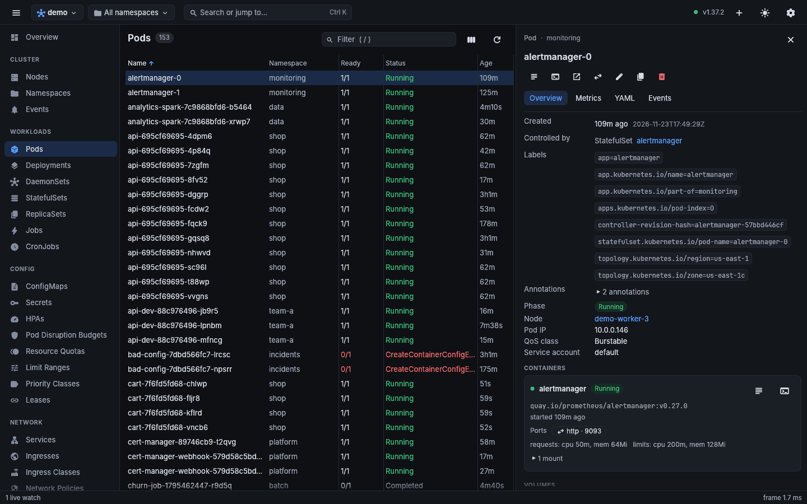
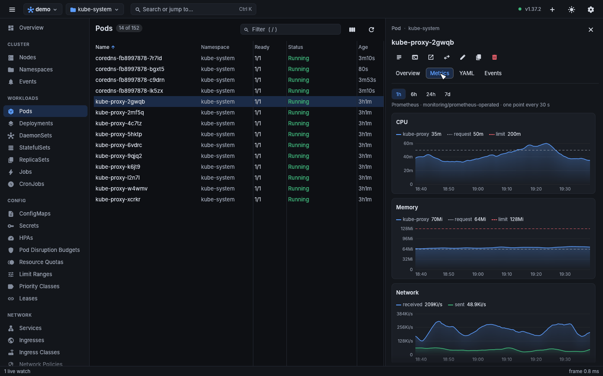
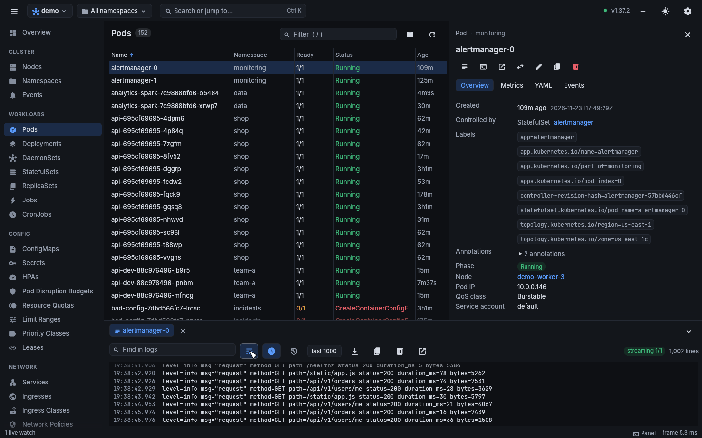
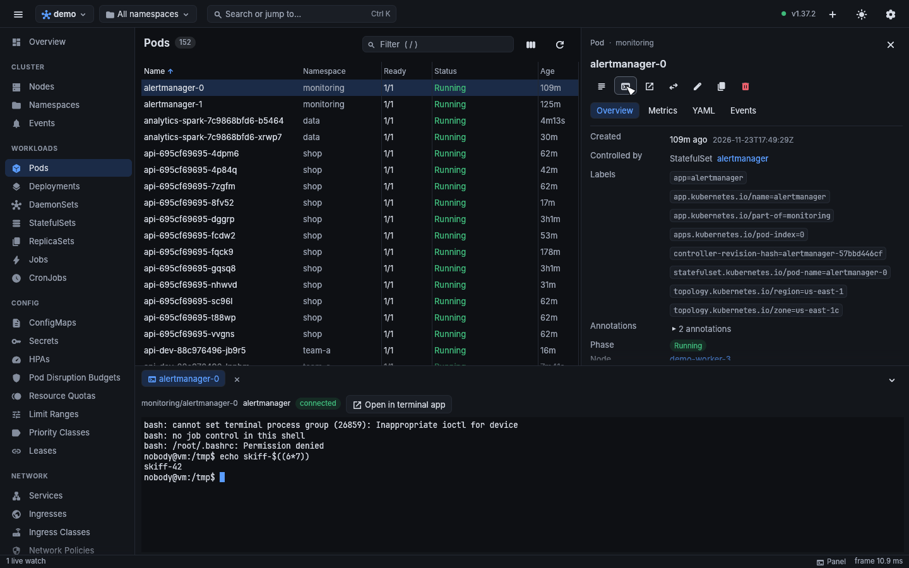
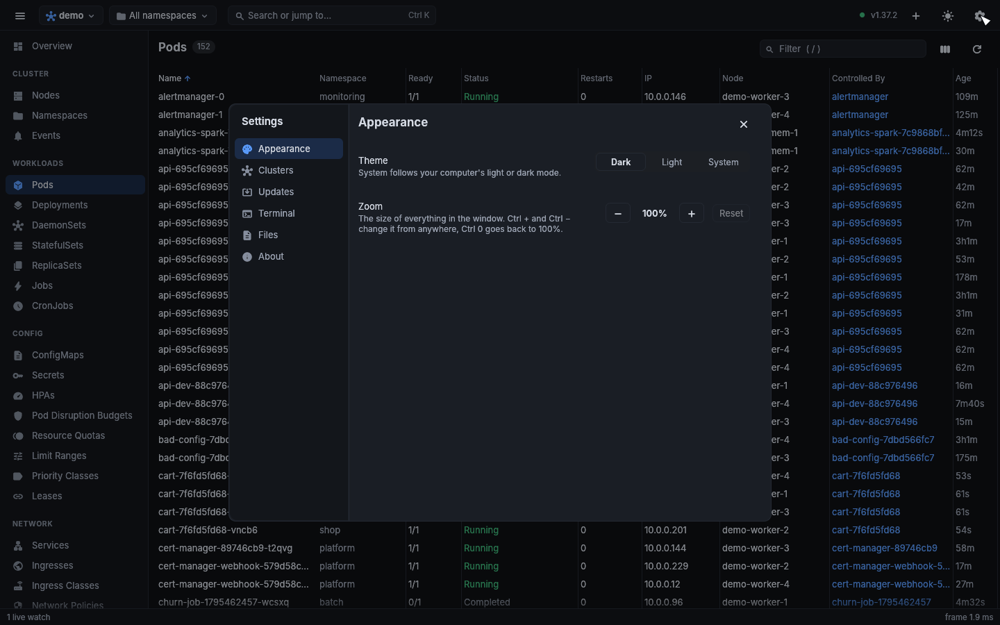
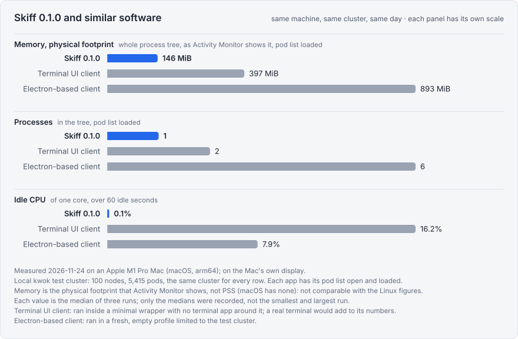

# Skiff

[](https://tsenkotsenkov.github.io/skiff/)
[](https://github.com/TsenkoTsenkov/skiff/actions/workflows/ci.yml)
[](https://github.com/TsenkoTsenkov/skiff/releases)
[](LICENSE)

[](https://buymeacoffee.com/tsenkotsenkov)

**A fast, native desktop app for looking after Kubernetes clusters: every
resource, live, with logs, shells, metrics and alerts, in one program
with no web view, no account and no telemetry. It reads your kubeconfig
and talks to the API server the way `kubectl` does.**

**Who it is for:** you look after one or many clusters, you already have
a working kubeconfig, and you want a window that opens at once, stays
quick on a cluster with thousands of pods, and does nothing with your
credentials that `kubectl` would not do.

**Website: <https://tsenkotsenkov.github.io/skiff/>**, with downloads,
screenshots and [the documentation](https://tsenkotsenkov.github.io/skiff/docs/).

[](docs/demo/skiff-demo.mp4)

A 43-second tour, recorded from the real app against a local test
cluster. Click it for the video.

- **Native.** One Rust program that draws its own interface. One process,
  no background service, and nothing listening on a port unless you
  start a port-forward.
- **Your kubeconfig, as it is.** EKS, GKE, AKS and OIDC work through the
  credential plugins your kubeconfig already names. Skiff has no sign-in
  of its own and stores no cluster credentials.
- **Only what you look at.** A resource type is listed and watched when
  you open it, and dropped a few minutes after you leave it.
- **Metrics and alerts from the Prometheus you already run**, reached
  through the Kubernetes API server: no second login, no port-forward.
  A cloud's managed Prometheus (Azure, AWS, Google Cloud) works too,
  signed in with the CLI you already use.
- **Guard rails.** Mark a cluster read-only and Skiff refuses every
  change to it.

[Website](https://tsenkotsenkov.github.io/skiff/) · [Install](#install) · [Quick start](#quick-start) · [Common setups](#common-setups) · [Features](#features) · [How it compares](#how-it-compares) · [Docs](#documentation) · [Security](#security) · [Support](#support)

## Install

| System | Download | Notes |
| --- | --- | --- |
| macOS 11 or newer, Apple Silicon and Intel | [Skiff-macos-universal.dmg](https://github.com/TsenkoTsenkov/skiff/releases/latest/download/Skiff-macos-universal.dmg) | Open it and drag Skiff to Applications |
| macOS 11 or newer, Apple Silicon only | [Skiff-macos-arm64.dmg](https://github.com/TsenkoTsenkov/skiff/releases/latest/download/Skiff-macos-arm64.dmg) | The same app without the Intel half: half the download, for M1 and later |
| Windows 10 or 11, 64-bit | [Skiff-windows-x64-setup.exe](https://github.com/TsenkoTsenkov/skiff/releases/latest/download/Skiff-windows-x64-setup.exe) | Installs for your user, no administrator rights. Portable: [Skiff-windows-x64.zip](https://github.com/TsenkoTsenkov/skiff/releases/latest/download/Skiff-windows-x64.zip) |
| Linux x86_64 | [AppImage](https://github.com/TsenkoTsenkov/skiff/releases/latest/download/Skiff-linux-x86_64.AppImage) · [.deb](https://github.com/TsenkoTsenkov/skiff/releases/latest/download/skiff_amd64.deb) · [.tar.gz](https://github.com/TsenkoTsenkov/skiff/releases/latest/download/skiff-linux-x86_64.tar.gz) | glibc 2.35 or newer (Ubuntu 22.04, Debian 12, Fedora 36, …) |
| Linux arm64 | [AppImage](https://github.com/TsenkoTsenkov/skiff/releases/latest/download/Skiff-linux-aarch64.AppImage) · [.deb](https://github.com/TsenkoTsenkov/skiff/releases/latest/download/skiff_arm64.deb) · [.tar.gz](https://github.com/TsenkoTsenkov/skiff/releases/latest/download/skiff-linux-aarch64.tar.gz) | |

These links always point at the latest **stable** release. Builds of the
main branch are on the [releases page](https://github.com/TsenkoTsenkov/skiff/releases),
marked as pre-releases.

Checksums: [SHA256SUMS](https://github.com/TsenkoTsenkov/skiff/releases/latest/download/SHA256SUMS).
[docs/install.md](docs/install.md) has the details for each system, how to
check a download, and how to build from source (`cargo build --release`,
Rust 1.95 or newer).

**With a package manager:**

```bash
brew tap tsenkotsenkov/skiff https://github.com/TsenkoTsenkov/skiff
brew install --cask tsenkotsenkov/skiff/skiff
```

```powershell
scoop bucket add skiff https://github.com/TsenkoTsenkov/skiff
scoop install skiff/skiff
```

This repository is the Homebrew tap and the Scoop bucket; both follow
each stable release.

**Is it signed?**

- **macOS:** signed with an Apple Developer ID and notarized by Apple. It
  opens like any other downloaded app.
- **Windows:** not signed yet. Windows shows "Windows protected your PC":
  choose **More info**, then **Run anyway**.
- **Linux:** the packages carry no signature.

On every system a download can be checked against `SHA256SUMS` and its
build provenance attestation (`gh attestation verify <file> -R
TsenkoTsenkov/skiff`). Who may change and release Skiff, where the
binaries are built and what the program sends over the network is in the
[code signing policy](CODE_SIGNING_POLICY.md). Each release's notes say
whether that build is signed.

**Updating.** Skiff tells you when a new version exists. On macOS it can
install it after verifying the download's code signature; on Windows and
Linux it opens the release page. One setting turns the check off.

## Quick start

1. Install Skiff and open it. It lists the clusters `kubectl` knows about:
   the files in `$KUBECONFIG`, or `~/.kube/config`.
2. No clusters yet? Get one into your kubeconfig with your cloud's command
   line (`aws eks update-kubeconfig`, `gcloud container clusters
   get-credentials`, `az aks get-credentials`), or choose **Add kubeconfig
   file…** on the welcome page. You can also drop a file onto the window.
3. Pick a cluster from the menu at the top left. The overview shows what is
   broken right now.
4. Press `Ctrl+K` (`Cmd+K` on a Mac) to jump to any resource type, object,
   namespace or action, and `?` for every keyboard shortcut.

EKS, GKE, AKS, OIDC and other sign-in setups work through the credential
plugins your kubeconfig already names: see [docs/clusters.md](docs/clusters.md).

## Common setups

**EKS, GKE, AKS, OIDC.** Put the cluster into your kubeconfig with your
cloud's own command; Skiff then runs the credential plugin that entry
names, as `kubectl` does. Switch back to Skiff and the cluster is listed.

```bash
aws eks update-kubeconfig --name <cluster> --region <region>
gcloud container clusters get-credentials <cluster> --region <region>
az aks get-credentials --resource-group <group> --name <cluster>
```

The plugin (`aws`, `gke-gcloud-auth-plugin`, `kubelogin`, an OIDC helper)
must be installed. When one is missing or a login has expired, Skiff says
which, and what to run: [docs/clusters.md](docs/clusters.md).

**Several kubeconfig files.** `$KUBECONFIG` with several paths works as it
does for `kubectl`. Or list files, folders and wildcards in Settings →
Clusters, which writes `config.json`:

```json
{ "kubeconfigs": ["$KUBECONFIG", "~/.kube/conf.d/*.yaml", "~/work/clusters"] }
```

`"$KUBECONFIG"` in that list stands for kubectl's own locations. For one
run, `skiff --kubeconfig a.yaml --kubeconfig b.yaml`.

**Read-only production clusters.** One switch per cluster, in the cluster
menu under Protection, in Settings → Clusters, or in the file:

```json
{ "clusters": { "production": { "read_only": true } } }
```

Skiff then refuses every change to that cluster before any request is
sent: no edit, apply, delete, scale or restart, no new shell and no new
port-forward. `"confirm": true` instead makes it ask before each change.
This guards against a slip of the hand in Skiff; it is not access
control.

**A Prometheus that is not found automatically.** Skiff looks for the
Prometheus Service by the names and labels of the common installations.
If yours is named differently, name it:

```json
{
  "clusters": {
    "production": {
      "prometheus": { "namespace": "monitoring", "service": "prometheus-operated", "port": 9090 }
    }
  }
}
```

It is reached through the API server, so your account needs `get` on
`services/proxy` for that Service: [docs/observability.md](docs/observability.md).

**A managed Prometheus outside the cluster** (Azure Monitor, Amazon
Managed Service for Prometheus, Google Cloud, Grafana Cloud, Mimir,
Thanos): give its address and how to sign in. The token comes from
`az`, `aws` or `gcloud` (or a command, variable or file you name);
Skiff stores none:

```json
{
  "clusters": {
    "aks-prod": {
      "prometheus": {
        "url": "https://myworkspace-abcd.westeurope.prometheus.monitor.azure.com",
        "auth": { "type": "azure" },
        "labels": { "cluster": "aks-prod" }
      }
    }
  }
}
```

Or set it up without editing anything: Settings → Clusters → **Change…**
next to "Prometheus", pick the service, and **Test connection**. See
[Prometheus outside the cluster](docs/observability.md#prometheus-outside-the-cluster).

`production` in these examples is the kubeconfig context name. Every key
of `config.json` is in [docs/configuration.md](docs/configuration.md).

## Features

- **Every resource type** the cluster serves, custom resources included,
  with live updates, instant filter (`/` or `Ctrl/Cmd+F`), sortable columns
  and a column chooser. Columns are sized to their content; drag one wider
  or narrower (double-click its edge for the default width), and the
  columns and widths you chose are remembered
- **Column filters** in the filter box: `node:worker-1`, `status:crash`,
  `ns:kube`, `label:app=web`. A column title can be shortened to any
  prefix, `:=` asks for the whole value (`node:=worker-1` leaves out
  `worker-10`) and `!` keeps the rows that do not match (`!status:running`)
- **Pods by node or namespace**: "Show pods" on a node or namespace
  (right-click, or the detail panel) opens the pods table filtered to it
- **Several clusters**: switch between kubeconfig contexts; connections
  stay warm. Namespace filter, one or many, remembered per cluster
- **Details** for each object: tailored summaries, conditions, related
  pods, events and links between objects
- **YAML**: view, edit and apply, with a warning when the object changed
  underneath your edit; create or update from a manifest with server-side
  apply, which reports field conflicts instead of overriding them
- **Logs**: follow, merge the pods of a workload, timestamps, previous
  container, find (`Ctrl/Cmd+F`) with highlighted matches
- **Shell** in any container, in a built-in terminal or in your own
  terminal app, with find in the scrollback (`Cmd+F` on macOS,
  `Ctrl+Shift+F` elsewhere, since `Ctrl+F` belongs to the shell);
  **port forwarding** for pods and services
- **Metrics**: CPU, memory, network and restart charts for pods, workloads
  and nodes from the Prometheus already in your cluster, with no extra
  credentials, or from a managed Prometheus outside it; a short history
  from metrics-server where there is none
- **Alerts**: the alerts firing in Prometheus, on the overview and on the
  object each one is about. Links into your Grafana if you set its address
- **Read-only clusters**: mark a cluster read-only and Skiff refuses every
  change to it, or have it ask before each change
- **Actions**: scale, restart, cordon and uncordon, suspend and resume
  cron jobs, delete
- **Settings** window (`Ctrl/Cmd+,`): theme (dark, light or follow the
  system), zoom, log history, kubeconfig files (those found in `~/.kube`
  are offered), the clusters with their connection state (open, reconnect,
  disconnect, hide from the menu), update channel, terminal app
- Vim-style keyboard navigation with [custom bindings](docs/keyboard.md#changing-the-keys)

| | |
| --- | --- |
|  |  |
|  |  |
|  |  |

## How it compares

<picture>
  <source media="(prefers-color-scheme: dark)" srcset="docs/img/compare-dark.svg">
  
</picture>

<picture>
  <source media="(prefers-color-scheme: dark)" srcset="docs/img/compare-macos-dark.svg">
  
</picture>

On macOS (an Apple M1 Pro) Skiff was measured next to a terminal UI
client and an Electron-based client: 146, 397 and 893 MiB of memory, 1, 2
and 6 processes, and 0.1, 16.2 and 7.9% of a core while idle; memory
there is the physical footprint Activity Monitor shows, a different
quantity from the PSS in the Linux figures, so the two are not
comparable. The method and caveats are in
[docs/benchmarks.md](docs/benchmarks.md#comparison-with-similar-software).
What each kind of client is good at, and when you would be better off
with another, is in [docs/choosing.md](docs/choosing.md).

The first figure, measured on Linux, holds only Skiff. Both are drawn
from results files; we publish only what we measured.

The launched 0.1.0 Linux binary against a local test cluster with 100
nodes and 5,415 pods, on a 4-vCPU VM **without a GPU** (every frame drawn
by a software rasterizer):

| | Measured |
| --- | --- |
| First frame built after launch | 118 ms (86 ms when started from a terminal) |
| Window visible | 161 ms |
| All 5,415 pods listed and live | 0.58 s |
| Memory with that table open (PSS) | 162 MiB, at least 92 MiB of it the software Vulkan stack |
| Processes / threads | 1 / 18 |
| CPU while idle | 0.5% of one core |
| Listening sockets | none |
| Size | executable 39.2 MB; .deb 11.3 MB; AppImage 15.4 MB; .tar.gz 15.7 MB |

Medians; the ranges, the method and the caveats are in
[docs/benchmarks.md](docs/benchmarks.md). Start-up times on macOS and
anything on Windows have not been measured.

What differs by design rather than by measurement: Skiff is one native
process without an embedded browser, it has no account and no telemetry,
and it has no plugin system. What it leaves out is listed under
[Deliberately not included](#deliberately-not-included).

## Documentation

| | |
| --- | --- |
| [Install and update](docs/install.md) | Files per system, first launch, update channels, checking a download, building from source |
| [Clusters and sign-in](docs/clusters.md) | Credential plugins, connection errors, proxies, read-only clusters, limited accounts |
| [Configuration](docs/configuration.md) | Every key of `config.json`, kubeconfig files, command-line options, environment variables |
| [Keyboard](docs/keyboard.md) | Every shortcut, the command palette, changing the keys |
| [Metrics and alerts](docs/observability.md) | The Metrics tab, firing alerts, how Prometheus is found, Grafana links |
| [Troubleshooting and FAQ](docs/troubleshooting.md) | The Windows first-launch warning, no clusters shown, a plugin that is not found, graphics problems, where files live |
| [Security](docs/security.md) | What Skiff connects to and what it does with your access |
| [Code signing policy](docs/code-signing-policy.md) | Who may release Skiff, where the binaries are built, what is signed, what is sent over the network |
| [Benchmarks](docs/benchmarks.md) | What was measured, how, and how to repeat it |
| [Choosing a client](docs/choosing.md) | The kinds of Kubernetes client, what each is good at, and when Skiff is not the right one |
| [Development](docs/development.md) | Code layout, local test clusters, tests |

The same pages, with navigation, are on the site:
<https://tsenkotsenkov.github.io/skiff/docs/>.

## Security

- **Your credentials stay where they are.** Skiff reads your kubeconfig and
  runs the credential plugins it names, as `kubectl` does. It has no
  account and stores no cluster credentials of its own.
- **Two network destinations.** The API server of the cluster you open,
  and `api.github.com` for the update check (anonymous; off with one
  setting). Prometheus is reached through the API server, not directly,
  unless you give the address of one outside the cluster
  (`prometheus.url`).
- **No telemetry**, no crash reporting and no analytics.
- **Lists do not fetch secret values.** Tables ask the server for rows,
  not objects; a Secret is fetched in full only when you open it, and a
  copied value is cleared from the clipboard after 60 seconds, unless
  you have copied something else by then.
- **What a cluster sends is not trusted.** Log lines, object sizes and
  terminal output are bounded; escape sequences in logs are removed; a
  program in a container cannot write to your clipboard.
- **Updates.** On Windows and Linux Skiff only tells you a new version
  exists and opens the release page. On macOS it installs an update only
  after the download's code signature verifies.

Details, limits and how to report a problem: [docs/security.md](docs/security.md)
and [SECURITY.md](SECURITY.md).

## Deliberately not included

Skiff stays one small program. It has no plugin system, no embedded
Grafana or other web view, no sign-in or VPN client of its own, no
incident management (acknowledging or silencing alerts), no hosted or team
mode, and it bundles neither `kubectl` nor `helm`. The reasons are in
[docs/observability.md](docs/observability.md#deliberately-not-there) and
[CONTRIBUTING.md](CONTRIBUTING.md#what-gets-in).

## Roadmap

Not there yet:

- A signed Windows build; winget and AUR packages
- Helm releases
- Node drain, triggering a cron job, actions on several rows at once
- Log search across history (Loki, Elasticsearch)
- In the built-in terminal: mouse clicks for programs that ask for them,
  input methods for CJK text, and CJK and emoji glyphs
- Merging your YAML edits into a newer version of the object

## Contributing

Bug reports and pull requests are welcome: see
[CONTRIBUTING.md](CONTRIBUTING.md) and
[docs/development.md](docs/development.md). `hack/cluster-up.sh` starts
two local test clusters, without Docker, to develop against. Changes are
listed in [CHANGELOG.md](CHANGELOG.md).

## Support

Skiff is free and MIT-licensed. If it saves you time, you can
[buy me a coffee](https://buymeacoffee.com/tsenkotsenkov). Bug reports and
pull requests help just as much.

[](https://buymeacoffee.com/tsenkotsenkov)

## Licence

[MIT](LICENSE). Bundled fonts and the crates Skiff is built from are
listed in [THIRD-PARTY-NOTICES.md](THIRD-PARTY-NOTICES.md).
