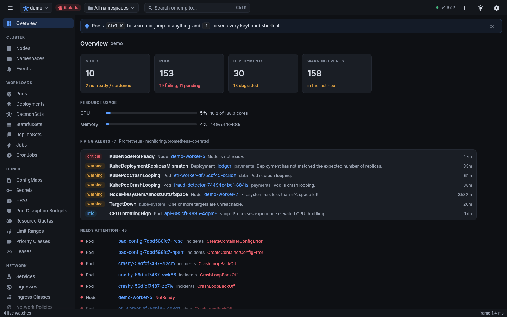
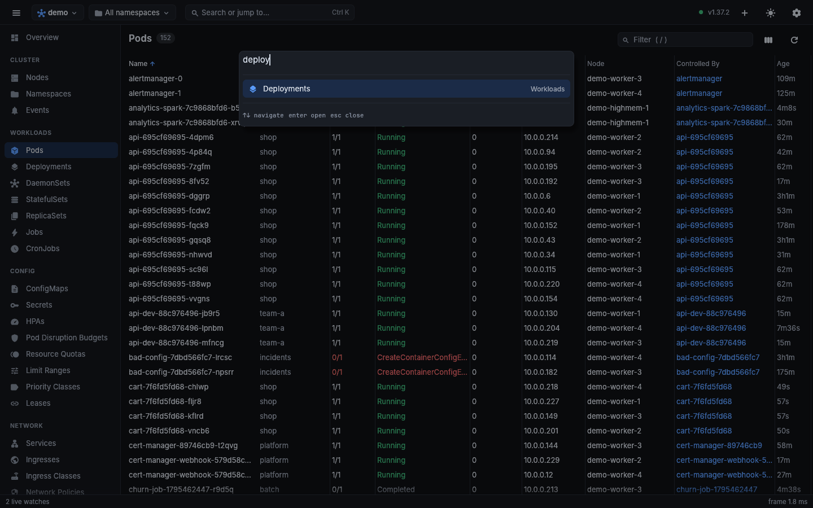

  

<h1 align="center">Skiff</h1>

  A fast, native desktop app for looking after Kubernetes clusters. 
  One program, no web view, no account, no telemetry. It reads your kubeconfig and talks to the API server the way <code>kubectl</code> does.

  
  
  

<picture>
  <source media="(prefers-color-scheme: light)" srcset="docs/img/overview-light.png">
  
</picture>

## Download

| System | File | Notes |
| --- | --- | --- |
| macOS 11 or newer, Apple Silicon and Intel | [Skiff-macos-universal.dmg](https://github.com/TsenkoTsenkov/skiff/releases/latest/download/Skiff-macos-universal.dmg) | Open it and drag Skiff to Applications |
| Windows 10 or 11, 64-bit | [Skiff-windows-x64-setup.exe](https://github.com/TsenkoTsenkov/skiff/releases/latest/download/Skiff-windows-x64-setup.exe) | Installs for your user, no administrator rights. Portable: [Skiff-windows-x64.zip](https://github.com/TsenkoTsenkov/skiff/releases/latest/download/Skiff-windows-x64.zip) |
| Linux x86_64 | [AppImage](https://github.com/TsenkoTsenkov/skiff/releases/latest/download/Skiff-linux-x86_64.AppImage) · [.deb](https://github.com/TsenkoTsenkov/skiff/releases/latest/download/skiff_amd64.deb) · [.tar.gz](https://github.com/TsenkoTsenkov/skiff/releases/latest/download/skiff-linux-x86_64.tar.gz) | glibc 2.35 or newer (Ubuntu 22.04, Debian 12, Fedora 36, …) |
| Linux arm64 | [AppImage](https://github.com/TsenkoTsenkov/skiff/releases/latest/download/Skiff-linux-aarch64.AppImage) · [.deb](https://github.com/TsenkoTsenkov/skiff/releases/latest/download/skiff_arm64.deb) · [.tar.gz](https://github.com/TsenkoTsenkov/skiff/releases/latest/download/skiff-linux-aarch64.tar.gz) | |

Checksums: [SHA256SUMS](https://github.com/TsenkoTsenkov/skiff/releases/latest/download/SHA256SUMS).
[docs/install.md](docs/install.md) has the details for each system, how to
check a download, and how to build from source.

**First launch.** The builds are not yet signed by Apple or Microsoft, so
both systems ask before running Skiff the first time:

- **macOS** says the app cannot be opened. Go to System Settings → Privacy &
  Security, scroll to the message about Skiff and choose **Open Anyway**.
- **Windows** shows "Windows protected your PC". Choose **More info**, then
  **Run anyway**.

Each release's notes say whether that build is signed; once it is, these
steps go away.

## Quick start

1. Install Skiff and open it. It lists the clusters `kubectl` knows about:
   the files in `$KUBECONFIG`, or `~/.kube/config`.
2. No clusters yet? Get one into your kubeconfig with your cloud's command
   line (`aws eks update-kubeconfig`, `gcloud container clusters
   get-credentials`, `az aks get-credentials`), or choose **Add kubeconfig
   file…** on the welcome page. You can also drop a file onto the window.
3. Pick a cluster from the menu at the top left. The overview shows what is
   broken right now.
4. Press `Ctrl+K` (`Cmd+K` on a Mac) to jump to any resource type, object,
   namespace or action, and `?` for every keyboard shortcut.

EKS, GKE, AKS, OIDC and other sign-in setups work through the credential
plugins your kubeconfig already names: see [docs/clusters.md](docs/clusters.md).

## Features

- **Every resource type** the cluster serves, custom resources included,
  with live updates, instant filter (`/`), sortable columns and a column
  chooser
- **Several clusters**: switch between kubeconfig contexts; connections
  stay warm. Namespace filter, one or many, remembered per cluster
- **Details** for each object: tailored summaries, conditions, related
  pods, events and links between objects
- **YAML**: view, edit and apply, with a warning when the object changed
  underneath your edit; create or update from a manifest with server-side
  apply, which reports field conflicts instead of overriding them
- **Logs**: follow, merge the pods of a workload, timestamps, previous
  container, find with highlighted matches
- **Shell** in any container, in a built-in terminal or in your own
  terminal app; **port forwarding** for pods and services
- **Metrics**: CPU, memory, network and restart charts for pods, workloads
  and nodes from the Prometheus already in your cluster, with no extra
  credentials; a short history from metrics-server where there is none
- **Alerts**: the alerts firing in Prometheus, on the overview and on the
  object each one is about. Links into your Grafana if you set its address
- **Read-only clusters**: mark a cluster read-only and Skiff refuses every
  change to it, or have it ask before each change
- **Actions**: scale, restart, cordon and uncordon, suspend and resume
  cron jobs, delete
- **Settings** window (`Ctrl/Cmd+,`): theme (dark, light or follow the
  system), zoom, kubeconfig files, update channel, terminal app
- Vim-style keyboard navigation with [custom bindings](docs/configuration.md#keyboard)

| | |
| --- | --- |
|  |  |
|  |  |
|  |  |

More: [observability](docs/observability.md) ·
[clusters and sign-in](docs/clusters.md) ·
[configuration and keyboard](docs/configuration.md)

## How it compares

We publish only what we measured, and so far we have measured only Skiff.
The launched 0.1.0 Linux binary against a local test cluster with 100
nodes and 5,415 pods, on a 4-vCPU VM **without a GPU** (every frame drawn
by a software rasterizer):

| | Measured |
| --- | --- |
| First frame built after launch | 118 ms (86 ms when started from a terminal) |
| Window visible | 160 ms |
| All 5,415 pods listed and live | 0.58 s |
| Memory with that table open (PSS) | 162 MiB, at least 92 MiB of it the software Vulkan stack |
| Processes / threads | 1 / 18 |
| CPU while idle | 0.5% of one core |
| Listening sockets | none |
| Size | executable 39.2 MB; .deb 11.3 MB; AppImage 15.4 MB |

Medians; the ranges, the method, the caveats and how to measure another
tool on your own machine with the same script are in
[docs/benchmarks.md](docs/benchmarks.md). Numbers on a real GPU, on macOS
and on Windows have not been measured.

## Security model

- **Your credentials stay where they are.** Skiff reads your kubeconfig and
  runs the credential plugins it names, as `kubectl` does. It has no
  account and stores no cluster credentials of its own.
- **Two network destinations.** The API server of the cluster you open,
  and `api.github.com` for the update check (anonymous; off with one
  setting). Prometheus is reached through the API server, not directly.
- **No telemetry**, no crash reporting and no analytics.
- **Lists do not fetch secret values.** Tables ask the server for rows,
  not objects; a Secret is fetched in full only when you open it, and a
  copied value is cleared from the clipboard after 60 seconds, unless
  you have copied something else by then.
- **What a cluster sends is not trusted.** Log lines, object sizes and
  terminal output are bounded; escape sequences in logs are removed; a
  program in a container cannot write to your clipboard.
- **Updates.** On Windows and Linux Skiff only tells you a new version
  exists and opens the release page. On macOS it installs an update only
  after the download's code signature verifies.

Details, limits and how to report a problem: [docs/security.md](docs/security.md)
and [SECURITY.md](SECURITY.md).

## Deliberately not included

Skiff stays one small program. It has no plugin system, no embedded
Grafana or other web view, no sign-in or VPN client of its own, no
incident management (acknowledging or silencing alerts), no hosted or team
mode, and it bundles neither `kubectl` nor `helm`. The reasons are in
[docs/observability.md](docs/observability.md#deliberately-not-there) and
[CONTRIBUTING.md](CONTRIBUTING.md#what-gets-in).

## Roadmap

Not there yet:

- Signed and notarized builds, then Homebrew and winget packages
- Helm releases
- Node drain, triggering a cron job, actions on several rows at once
- Log search across history (Loki, Elasticsearch)
- In the built-in terminal: mouse clicks for programs that ask for them,
  input methods for CJK text, and CJK and emoji glyphs
- Merging your YAML edits into a newer version of the object

## Contributing

Bug reports and pull requests are welcome: see
[CONTRIBUTING.md](CONTRIBUTING.md) and
[docs/development.md](docs/development.md). `hack/cluster-up.sh` starts
two local test clusters, without Docker, to develop against. Changes are
listed in [CHANGELOG.md](CHANGELOG.md).

## Licence

[MIT](LICENSE). Bundled fonts and the crates Skiff is built from are
listed in [THIRD-PARTY-NOTICES.md](THIRD-PARTY-NOTICES.md).
