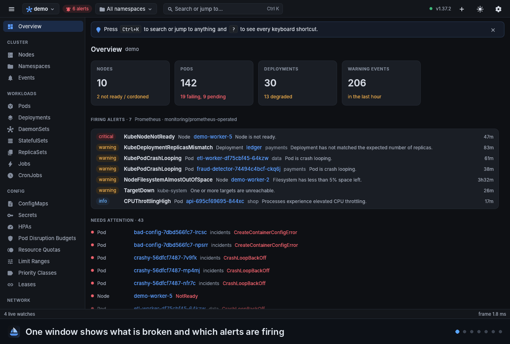

# Skiff documentation

Skiff is a native desktop app for looking after Kubernetes clusters. It
reads your kubeconfig and talks to the API server the way `kubectl` does;
it has no account, no telemetry and no web view. These pages describe the
program as it is in this repository.

[](demo/skiff-demo.mp4)

## Start here

1. **[Install and update](install.md).** Downloads for macOS, Windows and
   Linux, what is signed on each system, checking a
   download, building from source.
2. **[Clusters and sign-in](clusters.md).** EKS, GKE, AKS and OIDC through
   the credential plugins your kubeconfig names; proxies; read-only
   clusters; accounts limited to a namespace.
3. **[Keyboard](keyboard.md).** Every shortcut, and how to change the keys
   for moving around.

## Using Skiff

| Page | What is in it |
| --- | --- |
| [Install and update](install.md) | Files per system, signatures and first launch, update channels, checksums and attestations, building from source |
| [Clusters and sign-in](clusters.md) | Credential plugins, connection errors and what to do, proxies, read-only and ask-before-changes, limited accounts |
| [Configuration](configuration.md) | Every key of `config.json`, which kubeconfig files are read, command-line options, environment variables |
| [Keyboard](keyboard.md) | Shortcuts by place, the command palette, `keys.json` |
| [Metrics and alerts](observability.md) | The Metrics tab, firing alerts, how Prometheus is found, the permission it needs, Grafana links |
| [Troubleshooting and FAQ](troubleshooting.md) | The Windows first-launch warning, no clusters shown, a plugin that is not found, Prometheus not detected, graphics problems, where files live |

## How it behaves

| Page | What is in it |
| --- | --- |
| [Security](security.md) | What Skiff connects to, what it does with credentials and Secrets, how it treats what a cluster sends, how updates are checked |
| [Code signing policy](code-signing-policy.md) | Who may release Skiff, where the binaries are built, what is signed today, what the program sends over the network, how to report a problem |
| [Benchmarks](benchmarks.md) | Start-up time, memory, CPU and size, measured on the launched binary, with the method and the script to repeat it |

## Project

| Page | What is in it |
| --- | --- |
| [Development](development.md) | Code layout, the local test clusters, tests, screenshots, benchmarks |
| [Releasing](releasing.md) | The owner's checklist: going public, the site, signing, cutting a release |
| [Contributing](../CONTRIBUTING.md) | What gets accepted, and how to send it |
| [Changelog](../CHANGELOG.md) | What changed, release by release |
| [Reporting a security problem](../SECURITY.md) | Where to report, and what to expect |

## Building these pages

The same files are published as a site at
<https://tsenkotsenkov.github.io/skiff/docs/>. `hack/site-build.py`
(Python 3, standard library only) turns `docs/*.md` into `site/docs/*.html`
with the landing page's header, footer and stylesheet:

```bash
python3 hack/site-build.py
python3 -m http.server -d site 8000     # then open http://localhost:8000/
```

The build stops when a link between pages, or to a heading, leads
nowhere. The generated pages are not committed; the Pages workflow builds
them on every push to `main` that touches `docs/` or `site/`.
