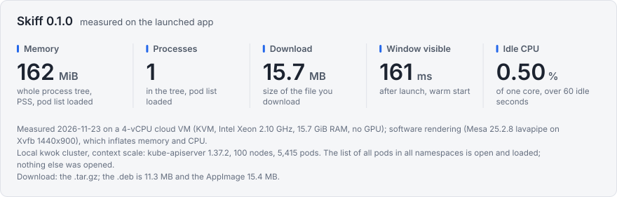

# Benchmarks

What Skiff costs the machine it runs on, measured on the real, launched
binary from the outside. Every number on this page was produced by
[`hack/bench/run.sh`](../hack/bench/README.md) and can be reproduced with it.

<picture>
  <source media="(prefers-color-scheme: dark)" srcset="img/compare-dark.svg">
  
</picture>

We publish only numbers we measured. Only Skiff has been measured so far,
so the figure and the
[comparison section](#comparison-with-similar-software) hold Skiff's row
alone. The same script measures any app; that section says how to measure
similar software on your own machine and add it.

- **Date:** 2026-11-23
- **Skiff:** 0.1.0, commit `65653da7bcf010df860f1d3ea6873bd00647032a`
  (clean tree), `cargo build --release -p skiff`,
  target `x86_64-unknown-linux-gnu`
- **Machine:** a cloud VM (KVM): 4 vCPUs, Intel Xeon @ 2.10 GHz, 15.7 GiB
  RAM, no swap, Ubuntu 24.04.5, Linux 6.18. **It has no GPU.**
- **Display:** Xvfb 21.1.12, 1440x900x24. Everything is drawn by Mesa
  25.2.8's software Vulkan driver (lavapipe: `llvmpipe (LLVM 20.1.2, 256
  bits)`, device type CPU). This inflates memory, see
  [Caveats](#caveats).
- **Cluster:** the local test bed (`hack/cluster-up.sh`), context `scale`:
  a real kube-apiserver 1.37.2 and etcd on the same machine with
  [kwok](https://kwok.sigs.k8s.io) simulating 100 nodes and 5,415 pods
  (plus about 3,000 each of ConfigMaps, Secrets and Services). The test
  bed's churn loop was stopped during all measurements.
- **Units:** memory in MiB (2^20 bytes); file sizes in MB (10^6 bytes).

## Results

Skiff is started as `skiff --context scale --view pods`: the list of all
pods in all namespaces. Each launch gets empty config and state
directories (a first run). The update check is off
(`SKIFF_NO_UPDATE_CHECK=1`) except where a row says otherwise.

### Launch

Wall time from just before the process is created to the moment Skiff
prints the event (`SKIFF_TRACE_STARTUP=1`). 10 launches each.

| | Median | Min - max |
| --- | --- | --- |
| First frame built, warm | 118 ms | 96 - 127 ms |
| Window visible on the X display, warm | 161 ms | 149 - 256 ms |
| All 5,415 pods listed and live, warm | 0.58 s | 0.51 - 0.97 s |
| First frame built, cold | 310 ms | 244 - 1,057 ms |
| All 5,415 pods listed and live, cold | 0.78 s | 0.68 - 1.86 s |
| First frame built, warm, started from a terminal | 86 ms | 79 - 121 ms |

- *Warm*: the program's files are in the page cache (it has been run
  before since boot). *Cold*: `echo 3 > /proc/sys/vm/drop_caches` before
  each launch, so the binary, the Vulkan driver and the fonts come from
  disk. The API server runs on the same machine and loses its cached files
  too, so the cold "pods listed" figure includes some of its recovery.
- "First frame built" is when the app has finished building its first
  frame, not when the pixels are on screen. "Window visible" is observed
  from outside (`xdotool`, polled, so it reads a few milliseconds late) in
  a separate set of 10 launches; in that set the first frame was built at
  122 ms (108 - 175).
- Skiff's own clock, which starts in `main`, reads 3 - 5 ms less than
  these wall times (10 ms less when cold): that is process creation and
  dynamic loading.
- Started from anything other than a terminal, Skiff runs the user's login
  shell once to read `PATH`, `KUBECONFIG` and proxy variables, as a
  desktop launcher would need. Here that is a stock `bash -l -i` and costs
  about 25 ms of the first frame (last row: same launch through a pseudo
  terminal, where the shell is not asked). A slow shell profile costs
  more. It does not delay the pod list (0.57 s, 0.49 - 1.04, from a
  terminal).
- One launch in ten took about 1 s to list the pods; the table shows it
  in the maximum.

### Steady state: pods table loaded

Measured 5 s after the pods were listed, then again after 60 idle seconds.
5 launches; median (min - max).

| | 5 s after load | After 60 s idle |
| --- | --- | --- |
| Memory, PSS, whole process tree | 162 MiB (161 - 163) | 167 MiB (166 - 168) |
| Memory, RSS, whole process tree | 165 MiB (164 - 166) | 170 MiB (169 - 171) |
| Processes | 1 | 1 |
| Threads | 18 | 17 |
| CPU over the 60 idle seconds | | 0.50% of one core (0.47 - 0.55): 0.30 s of CPU |
| Listening sockets (TCP and UDP) | none | none |

Where the 162 MiB is (PSS by mapping, one launch, 161 MiB total):

| Mapping | PSS |
| --- | --- |
| `libLLVM.so` (the software rasterizer's compiler) | 54 MiB |
| `libvulkan_*.so` (Mesa Vulkan drivers: lavapipe 7 MiB, and seven hardware drivers the loader maps while enumerating, 13 MiB) | 20 MiB |
| `memfd:allocation fd` (lavapipe's "GPU" memory, in RAM) | 18 MiB |
| the `skiff` executable (code, embedded fonts) | 25 MiB |
| heap and anonymous memory (the app's data, and the rasterizer's) | 37 MiB |
| everything else (libc, libstdc++, ...) | 7 MiB |

At least 92 MiB (57%) is the software Vulkan stack; how much of the
remaining heap is the rasterizer's cannot be told from outside. Memory on
a machine with a GPU has not been measured.

### Network and processes during the first 60 s

From socket snapshots five times a second (`ss`), and from a second launch
under `strace` that records every `connect`, `bind`, `listen` and `exec`.

| | Update check off | Update check on (the default) |
| --- | --- | --- |
| TCP/UDP connections made | `127.0.0.1:18081`, the API server of the kubeconfig context (2 - 3 connections) | the same, plus **one** HTTPS request by `/usr/bin/curl` to `https://api.github.com/repos/TsenkoTsenkov/skiff/releases/latest` |
| `bind()` on a network address, `listen()` | none | none |
| Local (Unix) sockets | the X server; attempts on the D-Bus session bus and glibc's `nscd` (neither exists on this machine) | the same |
| Programs started | the login shell once, for about 0.1 s (it ran `groups`, `lesspipe`, `dircolors`, ... from the stock Ubuntu profile, and `env`) | the same, plus `curl` once, for under 0.5 s |
| Long-lived processes | 1 | 1 |

About the update check, as observed:

- This machine sends HTTPS through a proxy (`HTTPS_PROXY`), so the socket
  curl opened went to the proxy, `127.0.0.1:41833`; the URL above is from
  curl's command line. With the proxy variables removed, the trace shows
  one DNS query (to the machine's resolver, `8.8.8.8:53`) and one
  connection to `140.82.112.5:443`, an address `api.github.com` resolved
  to.
- The request is anonymous: curl's arguments carry no credentials, and in
  this build the code path that reads a token is unreachable
  (`retry_with_token` in `crates/skiff/src/update.rs` requires a
  non-default `SKIFF_UPDATE_REPO`).
- With the check on, memory and idle CPU were the same within noise (one
  launch: 160 MiB PSS after load, 0.50% of one core).
- The check repeats every 4 hours while the app is open
  (`CHECK_EVERY`); that was not observed in a 60 s window.

### Size

| | Bytes | |
| --- | --- | --- |
| `skiff` executable (stripped, thin LTO) | 39,172,816 | 39.2 MB |
| `skiff-linux-x86_64.tar.gz` | 15,727,036 | 15.7 MB |
| `skiff_amd64.deb` | 11,334,480 | 11.3 MB |
| `Skiff-linux-x86_64.AppImage` | 15,350,264 | 15.4 MB |

Packages built by `hack/linux-package.sh --binary target/release/skiff`.
The executable links dynamically only to `libc`, `libm` and `libgcc_s`
(`ldd`); at run time it loads the system's X11/Wayland, xkbcommon and
Vulkan or OpenGL libraries, which are not in any package.

### In-process numbers (the earlier README's table)

Earlier versions of the README had a performance table of their own. (The
README now shows numbers from this page instead.) That table came from a
test harness that runs the app inside the test process without a window
(`cargo test --release -p skiff --test perf -- --ignored --nocapture`),
not from the launched binary. Re-run on this commit, 3 runs:

| | The earlier README said | In-process, this commit | Launched binary, this page |
| --- | --- | --- | --- |
| First frame after launch | 60 - 120 ms | app constructed 53 - 55 ms; first rows 73 - 76 ms | 118 ms (96 - 127); 86 ms from a terminal |
| All 5,415 pods listed and live | 0.4 - 0.5 s | 0.48 - 0.51 s | 0.58 s (0.51 - 0.97) |
| Frame cost with the pods table open | about 1 ms | 1.2 - 1.4 ms | not measured |
| Re-filter / re-sort 5,415 rows | 1 - 5 ms | recompute 1.1 - 4.3 ms; whole click or keystroke frames 5.4 - 12.3 ms | not measured |
| Open an object's details | about 20 ms | 10 - 12 ms | not measured |
| Switch to another resource type (3,000 rows) | about 0.1 s | 0.08 - 0.16 s | not measured |
| Memory held per pod row | under 1 KB | not printed by the test; not re-measured | not measured |
| CPU while idle on that table | under 1% of one core | not measured by the test | 0.50% (0.47 - 0.55) |
| Binary | 35 MB | | 39.2 MB |
| Process memory (software rasterizer) | about 165 MB | 131 - 133 MiB peak RSS of the test process | 162 MiB PSS, 165 MiB RSS |

Differences from the earlier README worth knowing:

- The binary is 4 MB larger than the earlier README said (39.2 MB, not
  35 MB).
- The launched binary lists the pods in a median of 0.58 s; the earlier
  README's 0.4 - 0.5 s is the in-process figure and is at the fast end of
  what the real app does.
- The first frame of the launched app is inside the earlier README's
  range only when started from a terminal; from a launcher it is at its
  upper edge.
- "Re-sort 1 - 5 ms" is the recompute alone; the frames a click takes are
  8 - 12 ms.
- Nothing measured here is slower than the earlier README by more than
  that. We
  have no earlier run of this page's method to compare with, so this is
  not evidence for or against a regression in the launched binary.

## Method

All of it is `hack/bench/run.sh skiff --runs 10 --xvfb`; the details of
each number are in [hack/bench/README.md](../hack/bench/README.md). In
short:

| Number | How |
| --- | --- |
| Launch timings | the harness notes the time before `fork`/`exec` and timestamps each line the app prints; `SKIFF_TRACE_STARTUP=1` makes Skiff print when the first frame was built and when the open table is fully listed and its watch is live |
| Process tree | the launched process, its descendants and anything else in its session, from `/proc` |
| Memory | `Pss` and `Rss` from `/proc/<pid>/smaps_rollup`, summed over the tree. PSS counts shared pages once across the processes sharing them, so it is the figure that can be compared between a one-process and a many-process app |
| Threads | `Threads` in `/proc/<pid>/status`, summed |
| Idle CPU | user + system time of the tree from `/proc/<pid>/stat`, before and after 60 s with nobody touching the app |
| Listening sockets, remote addresses | `ss -H -a -n -p -t` / `-u`, filtered to the tree, every 0.2 s for 60 s from launch |
| Every connection | a separate 60 s launch under `strace -f -e trace=connect,bind,listen,execve` |
| Sizes | file sizes |

Raw results (JSON, the app's output, the strace logs and a screenshot of
the pods table taken at the end of the idle window) are written to the
`--out` directory; they are not checked in.

## Caveats

- **Software rendering.** No GPU: every frame is rasterized on the CPU and
  the "GPU" memory is ordinary RAM. That raises memory (see the mapping
  table) and makes each frame cost CPU. Numbers on real hardware, and on
  macOS and Windows, have not been measured. They are expected to differ
  and nothing here says in which direction for CPU.
- **Simulated pods.** kwok pods have no containers. Listing, watching,
  sorting and opening objects are real API traffic; logs, exec, port
  forwards and metrics from real kubelets are not exercised, and this page
  says nothing about them.
- **Skiff watches only the views that are open.** These numbers are for
  one open view, the pods table (the status bar in the screenshot reads
  "1 live watch"). Each further view opened adds its rows and a watch
  until three minutes after it is left (`IDLE_EVICT_SECS`). A session that
  visits many views was not measured.
- **Local API server.** There is no network latency. Against a remote
  cluster "pods listed" is dominated by the round trips.
- **A VM with four cores, shared.** Reviewers were reading code on the
  same machine during the run; timings have the spread the tables show.
- **Small samples.** 10 launches per timing, 5 per steady-state figure,
  one per trace.
- **Linux only.** macOS and Windows builds were not run.

## Comparison with similar software

**Only Skiff has been measured so far.** No number for any other program
appears on this page, and the figure at the top shows Skiff's row
alone.

Why: a number is published here only when it was measured by this
procedure under the same conditions as the rows next to it, which means
the same machine, the same cluster, the same day and the same state (the
list of all pods, loaded, nothing else opened). Memory, CPU and launch
time depend on all of these. On this machine a software rasterizer alone
accounts for more than half of Skiff's memory (see
[Caveats](#caveats)), and it would cost a different amount in a program
that draws differently. Figures taken from somewhere else, such as a
vendor's page, a review or another machine, cannot be set beside ours
honestly, so we do not use them. Other programs have not been installed
or run in the environment where Skiff's numbers were taken.

When other rows exist they are identified by what kind of program they
are ("Electron-based client A", "terminal client in a terminal
emulator"), not by product name. The point of the comparison is what an
architecture costs, and a neutral label keeps it from reading as a claim
about somebody's product that they have had no chance to check.

The numbers behind the figure are in
[`hack/bench/results/`](../hack/bench/results/), one file for each
machine and day:

| Row | Memory, PSS | Processes | Download | Window visible, warm | Idle CPU, % of one core |
| --- | --- | --- | --- | --- | --- |
| Skiff 0.1.0 (`65653da`), update check off, software rendering | 162 MiB (161 - 163) | 1 | 15.7 MB (.tar.gz; .deb 11.3 MB, AppImage 15.4 MB) | 161 ms (149 - 256) | 0.50 (0.47 - 0.55) |

### Measure similar software on your own machine

You need a Linux machine with an X display (or `Xvfb`), `python3`,
`xdotool` and the programs you want to compare. Do everything on **one**
machine, on one day, against the same cluster.

1. Start the test cluster and build Skiff:

   ```sh
   hack/cluster-up.sh
   export KUBECONFIG=$PWD/hack/kubeconfig
   cargo build --release -p skiff
   hack/linux-package.sh --binary target/release/skiff --out target/dist
   ```

2. Measure Skiff. This writes its results to `target/bench/mine` and
   takes about eight minutes:

   ```sh
   hack/bench/run.sh skiff --runs 10 --out target/bench/mine
   ```

   Add `--xvfb` only if every program in the comparison will be measured
   under Xvfb; see the rules below.

3. Measure the other program with the generic mode. `--label` names the
   raw files and stays on your machine; `--installed` is the installed
   program; the launch command follows `--`:

   ```sh
   hack/bench/run.sh app --label "other 1.2.3" --window-runs 10 \
     --installed /path/to/installed/app --out target/bench/mine \
     -- /path/to/installed/app
   ```

   The script first launches the program ten times and times each launch
   until a window is visible. Then it starts it once more and asks you to
   open the list of all pods in all namespaces of the `scale` context.
   **Press Enter in the terminal when the list is fully loaded**, then
   leave the program alone. Five seconds later the script records memory
   and processes, watches CPU for 60 idle seconds, saves a screenshot and
   closes the program. Do this three times (a different `--out` each
   time, or move the files) if you intend to publish the result.

4. Start a results file for your machine by copying ours and editing its
   `conditions` (the facts are in `target/bench/mine/machine.txt`), then
   add the rows:

   ```sh
   cp hack/bench/results/2026-11-23-linux-x86_64-kvm.json hack/bench/results/mine.json
   # edit "conditions" in mine.json, and set "rows" to []
   hack/bench/results.py add hack/bench/results/mine.json --subject \
     --label "Skiff 0.1.0" --category native \
     --steady "target/bench/mine/Skiff-0.1.0-x86_64-unknown-linux-gnu.steady.json" \
     --window "target/bench/mine/Skiff-0.1.0-x86_64-unknown-linux-gnu.startup-window.json" \
     --download target/dist/skiff-linux-x86_64.tar.gz
   hack/bench/results.py add hack/bench/results/mine.json \
     --label "Electron-based client A" --category electron \
     --steady target/bench/mine/other-1.2.3.steady.json \
     --window target/bench/mine/other-1.2.3.startup-window.json \
     --download ~/Downloads/the-file-you-downloaded
   ```

   Repeat `--steady` for each of several runs; the row then holds the
   median and the range. The label in the results file is a neutral
   description, never a product name. The categories and the file format
   are described in
   [hack/bench/README.md](../hack/bench/README.md#the-results-file).

5. Draw the figures:

   ```sh
   hack/bench/chart.py hack/bench/results/mine.json --out target/bench/mine
   ```

   This writes `compare-light.svg` and `compare-dark.svg`. With two or
   more rows the figure is one panel of bars for each metric. Without
   `--out` the figures in `docs/img` are replaced; `--copy site/img`
   writes the website's copies too.

Rules, in short (the full list is in
[hack/bench/README.md](../hack/bench/README.md)):

- Do not mix rows from different machines or days in one file, and do
  not copy a number from anywhere but the script's output.
- Either every row is measured on the real display or every row under
  `--xvfb`. Xvfb has no GPU.
- A program measured inside a terminal emulator or a browser includes
  the terminal emulator or the browser.
- "Window visible" is when any window of the program is on the display,
  even an empty one or a splash screen. It is not the time until pods are
  listed. That time is published for Skiff only (see [Launch](#launch)),
  because Skiff prints it; a program that does not say when its list is
  complete cannot be timed without a stopwatch, and we will not publish
  stopwatch numbers next to instrumented ones.
- "Download" is the size of one file, the one a user downloads to
  install the program on this platform. Say which in the row's note.

## What Skiff does and does not do

Each line was checked against the code at the commit above or against a
measurement on this page; the check is named.

- **No account, no sign-in.** There is no login code and no endpoint to
  log in to: the only URLs in the sources outside tests are
  `https://api.github.com/` (updates), `https://github.com/` (links to the
  release page and the project, opened in the browser) and one example
  runbook URL in a test fixture (`grep` for `http` in `crates/*/src`).
- **No telemetry.** Measured: in 60 s the process tree connected to the
  API server and, with the update check on, made one request to
  `api.github.com`; nothing else (strace, both runs). The dependency tree
  contains no HTTP client other than the Kubernetes one (`hyper`, used by
  `kube`), and no analytics or crash-reporting crate.
- **Network destinations.** (1) The API server of the context you open,
  including any proxy or credential plugin your kubeconfig names, which
  `kube` runs as `kubectl` would. (2) `api.github.com`, for the update
  check: once at start and every 4 hours, anonymous, by the system's
  `curl`; off with `"updates": {"check": false}` in `config.json` or
  `SKIFF_NO_UPDATE_CHECK=1` (`crates/skiff/src/update.rs`). Prometheus
  charts and alerts are fetched through the API server's service proxy,
  not from a second address (`crates/skiff-core/src/prom.rs`). Grafana
  links open in your browser; Skiff does not fetch them.
- **No bundled kubectl or helm.** The packages contain one executable
  (`hack/linux-package.sh`); no binary is embedded in it (`include_bytes!`
  is used for three fonts and two icon sizes only; the .deb holds
  `usr/bin/skiff`, a desktop entry, icons and metadata). Your own `kubectl` is run
  only by "open in my terminal" (`crates/skiff/src/external.rs`). Skiff
  has no Helm features.
- **No local listening proxy.** Measured: no listening socket, no
  `bind()` on a network address and no `listen()` call in 60 s. The only
  listener in the code outside tests is a port-forward the user starts,
  bound to `127.0.0.1` (`crates/skiff-core/src/forward.rs`, `start`). Port
  forwards were not exercised in these runs.
- **Secret values are not fetched for lists.** Lists use the server-side
  Table API (`TABLE_ACCEPT` in `crates/skiff-core/src/watch.rs`); full
  objects are requested only for nodes and events
  (`include_object` in `crates/skiff-core/src/views.rs`). Checked against
  the test API server: the Secrets list requested with Skiff's `Accept`
  header returned 500 rows of `PartialObjectMetadata` (name, type, key
  count, age), none with `data`. Two limits: metadata includes
  annotations, so a Secret created with `kubectl apply` carries its values
  in the `last-applied-configuration` annotation, which the server does
  send; and opening a Secret fetches it in full, as it must.
- **Short-lived helper processes, not none.** One long-lived process.
  Measured at start: the login shell (not when started from a terminal)
  and `curl` (update check). From the code, on request only: your terminal
  app and `kubectl`, `xdg-open`/`open` for links and folders, and on macOS
  the update installer's `codesign`, `ditto` and `/bin/sh`.
- **Update verification.** Windows and Linux builds never install
  anything: they show that a version exists and open the release page.
  macOS builds install only after `codesign --verify --deep --strict`
  passes on the download, and a build compiled with `SKIFF_TEAM_ID`
  additionally requires that Developer ID team
  (`crates/skiff/src/update.rs`, `verify`). This is read from the code;
  no macOS build was run here, and a build without `SKIFF_TEAM_ID` checks
  only that the signature is intact, not who made it.
- **TLS.** `rustls` with `ring`; no OpenSSL is linked (`cargo tree`;
  `ldd` shows only libc, libm and libgcc_s).
- **Licence.** MIT (`LICENSE`, `Cargo.toml`).
- **Dependencies.** 415 third-party crates (418 unique crate versions
  including Skiff's own three; 395 distinct names) are compiled into the
  Linux binary:
  `cargo tree -p skiff -e normal --target x86_64-unknown-linux-gnu --prefix none | sed 's/ (\*)$//' | sort -u | wc -l`.
  `Cargo.lock` lists 597 packages across all platforms and build and test
  dependencies. This is a count, not a claim that it is small; CI runs
  `cargo-deny` against the advisory database.
- **Not claimed.** That Skiff has no vulnerabilities (it is new and has
  had no independent review), anything about memory or speed on a real
  GPU, and anything about other software.
