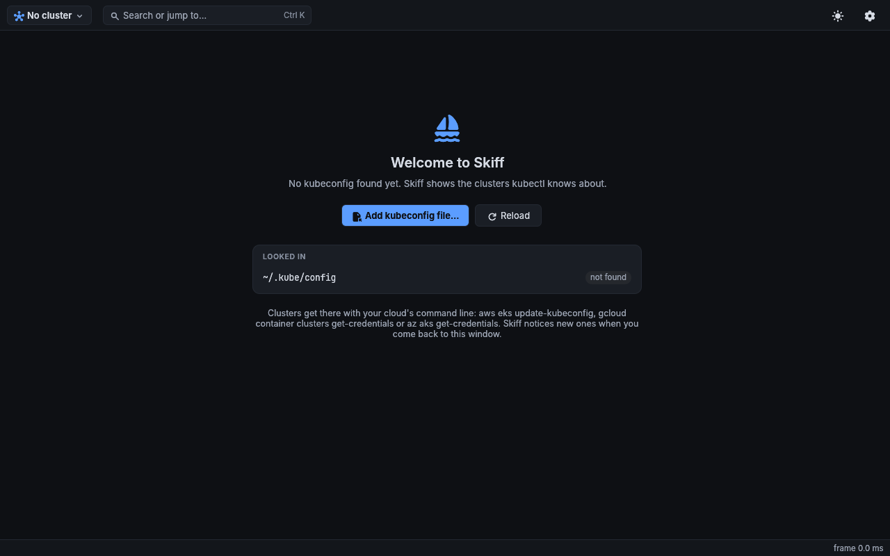

# Configuration

Skiff works without any configuration. Most of what is here can also be
changed in the Settings window (`Ctrl+,`, or `Cmd+,` on a Mac), which
writes the same file.

- [config.json](#configjson)
- [Which kubeconfig files are read](#which-kubeconfig-files-are-read)
- [Keyboard](#keyboard) and [keys.json](#keysjson); the shortcuts themselves are in [keyboard.md](keyboard.md)
- [Command-line options](#command-line-options)
- [Environment variables](#environment-variables)

## config.json

| System | Location |
| --- | --- |
| Linux, macOS | `$XDG_CONFIG_HOME/skiff/config.json`, or `~/.config/skiff/config.json` |
| Windows | `%APPDATA%\skiff\config.json` |
| Anywhere | the file named by `$SKIFF_CONFIG` |

Settings → Files shows the path in use and opens the file in your editor
(creating it as `{}` if it does not exist).

Every key is optional. Loading is lenient: a mistake in one key loses only
that key, and Skiff shows a notice saying which key and what is wrong.
Keys Skiff does not know are reported and otherwise left alone. A file
that is not valid JSON is not used at all: Skiff says so, runs with the
default settings, and, because it cannot know which clusters you
protected, treats every cluster as read-only until the file is fixed. When Skiff
saves a setting it changes only that key in the file as it is on disk, so
your own edits and unknown keys survive (the keys are written in
alphabetical order). The file is re-read when the window gets the focus
back after you edited it. There are no secrets in it.

| Key | Type | Default | Meaning |
| --- | --- | --- | --- |
| `kubeconfigs` | list of paths | `$KUBECONFIG`, else `~/.kube/config` | Kubeconfig files to read. An entry is a file or a directory (every file in it); it may start with `~` and use `*` in its last part. The entry `"$KUBECONFIG"` stands for kubectl's own locations (the files `$KUBECONFIG` lists, else `~/.kube/config`), looked up each time the files are read. When set, nothing else is read. |
| `updates.check` | true or false | `true` | Look for a new version of Skiff at startup. `SKIFF_NO_UPDATE_CHECK=1` also turns it off. |
| `updates.channel` | `"stable"` or `"nightly"` | `"stable"` | Which releases to offer: stable releases only, or every build of the main branch. |
| `terminal` | text | Skiff picks one | The terminal app for "open in terminal": a name such as `iTerm`, `Ghostty` or `kitty`, or on Linux a program path. `$SKIFF_TERMINAL` wins over it. |
| `theme` | `"dark"`, `"light"` or `"system"` | `"dark"` | The colours of the window. `"system"` follows the light or dark mode of your computer. |
| `zoom` | number, 0.5 to 3.0 | `1.0` | Size of everything in the window. Also changed by the zoom shortcuts. |
| `clusters.<context>.read_only` | true or false | `false` | Refuse every change in this cluster: no edit, delete, scale or restart, and no new shell or port-forward. Shells and port-forwards that are already open keep running until closed. |
| `clusters.<context>.confirm` | true or false | `false` | Ask before every change in this cluster, also for the ones that normally go ahead at once. |
| `clusters.<context>.prometheus.namespace` | text | found automatically | Namespace of the Prometheus Service to chart from. Set namespace and service to skip the automatic search. |
| `clusters.<context>.prometheus.service` | text | found automatically | Name of the Prometheus Service. It is reached through the API server, with your cluster credentials. |
| `clusters.<context>.prometheus.port` | number, 1 to 65535 | `9090` | Port of the Prometheus Service. |
| `clusters.<context>.prometheus.scheme` | `"http"` or `"https"` | `"http"` | What Prometheus itself speaks inside the cluster. |
| `clusters.<context>.prometheus.path_prefix` | text | `""` | Path in front of `/api/v1`, for example `/select/0/prometheus` for VictoriaMetrics. |
| `clusters.<context>.grafana_url` | http or https URL | none | Address of your Grafana, for "Open in Grafana" links. Opened in the browser; no login is stored. |

`<context>` is the name of a kubeconfig context. This table is the one in
the program (`KEYS` in `crates/skiff/src/config.rs`); the loader accepts
exactly these keys.

A complete file using every key:

```json
{
  "kubeconfigs": ["$KUBECONFIG", "~/.kube/conf.d/*.yaml"],
  "updates": { "check": true, "channel": "stable" },
  "terminal": "iTerm",
  "theme": "system",
  "zoom": 1.0,
  "clusters": {
    "production": {
      "read_only": true,
      "confirm": true,
      "prometheus": {
        "namespace": "monitoring",
        "service": "prometheus-operated",
        "port": 9090,
        "scheme": "http",
        "path_prefix": ""
      },
      "grafana_url": "https://grafana.example.com"
    }
  }
}
```

JSON has no comments. Notes on single keys:

- `prometheus`: a mistake in one of its fields drops the whole override,
  with a warning, and the automatic search is used. See
  [observability.md](observability.md).
- `grafana_url`: must be an `http://` or `https://` address without a user
  name or password in it.
- `read_only` and `confirm` are also in the cluster menu and in
  Settings → Clusters. See [clusters.md](clusters.md#read-only-clusters).
- `--light` on the command line overrides `theme` for that run.

Window state (pane sizes, the last view, the namespaces selected per
cluster) is not in this file. It is kept separately in the application
data folder of your system and needs no editing; the folder is named in
[troubleshooting.md](troubleshooting.md#where-skiff-keeps-its-files).

## Which kubeconfig files are read



The first of these that applies:

1. `--kubeconfig <path>` on the command line (repeat it to merge several).
2. `kubeconfigs` in `config.json`. Only what the list names is read; the
   entry `"$KUBECONFIG"` in it names the two places below.
3. The path list in `$KUBECONFIG`.
4. `~/.kube/config` (Windows: `%USERPROFILE%\.kube\config`).

Rules:

- Several files are merged the way `kubectl` merges them: for a context,
  cluster or user with the same name, the first file wins.
- A file that does not exist is skipped. A file that cannot be parsed is
  reported by name (in the cluster menu and on the welcome page) and the
  others are still used.
- In `kubeconfigs`, an entry may be a directory, which means every file
  directly in it except hidden files and editor backups (`name~`), and
  may use `~` and `*` or `?` wildcards in its last part, for example
  `~/.kube/conf.d/*.yaml`.
- The entry `"$KUBECONFIG"` (written exactly like that; it is not a
  general way to use environment variables) stands for what `kubectl`
  reads: the files listed in `$KUBECONFIG`, or `~/.kube/config` when that
  is not set. It is looked up every time the files are read, so a list
  that contains it keeps following your environment.
- **Add kubeconfig file…** (welcome page, cluster menu, Settings →
  Clusters, the palette, or dropping a file on the window) writes
  `kubeconfigs` for you. If there was no list yet, it becomes
  `["$KUBECONFIG", "<the new file>"]`: kubectl's locations, still
  followed, and the new file. From then on only the list is read; take
  the `"$KUBECONFIG"` entry off it (Settings → Clusters) to stop reading
  kubectl's locations, or remove the key, or choose "Use kubectl's
  locations" there, to go back to them alone.
- The files are read again when the window gets the focus back and one of
  them has changed, and by **Reload kubeconfig** in the cluster menu or
  the palette. A cluster you added with `aws eks update-kubeconfig` shows
  up when you switch back to Skiff.
- Started from the Dock, the Finder or a Linux desktop launcher, Skiff
  takes `KUBECONFIG` from your login shell if it is not already set.

## Keyboard

Every shortcut is listed in [keyboard.md](keyboard.md), and in the app
under `?`. The keys for moving around can be changed, in a second file.

### keys.json

Skiff reads `keys.json` from the same folder as `config.json` (or the
file named by `$SKIFF_KEYMAP`); Settings → Files opens it, writing the
defaults first if it does not exist. It maps actions to lists of keys;
actions it leaves out keep their defaults, and `[]` unbinds one:

```json
{
  "down": ["n", "ArrowDown"],
  "up": ["e", "ArrowUp"]
}
```

The thirteen actions, their default keys and how keys are written are in
[keyboard.md](keyboard.md#changing-the-keys). If the file has mistakes,
Skiff says so and uses the parts it understood. On Windows a `keys.json`
at the older location `%USERPROFILE%\.config\skiff` is still used while
there is none in `%APPDATA%\skiff`.

## Command-line options

```
skiff [OPTIONS]

-c, --context <NAME>     Open this kubeconfig context (default: last used / current)
-n, --namespace <NS>     Start with only this namespace selected
    --kubeconfig <PATH>  Read clusters from this kubeconfig file instead of the
                         configured ones; repeat it to merge several files
    --view <RESOURCE>    Start on a resource view, e.g. pods or deployments.apps
    --light              Use the light theme
-h, --help               Show this help
-V, --version            Show the version
```

A value can follow its option (`--context dev`) or be attached to a long
one (`--context=dev`). `--version` prints
`skiff <version> (build <N>, <commit>, <target>)`; the build number and
commit appear only in builds made by the release workflow.

On Windows, Skiff is a windowed program: started from a terminal it
prints to that terminal, but the prompt returns before the output
appears.

## Environment variables

Read when Skiff runs:

| Variable | Effect |
| --- | --- |
| `SKIFF_CONFIG` | Path of the config file, instead of the default location. |
| `SKIFF_KEYMAP` | Path of the key bindings file, instead of `keys.json` next to the config file. |
| `SKIFF_NO_UPDATE_CHECK` | Set to anything: no automatic update check, whatever the config says. |
| `SKIFF_TERMINAL` | The terminal app for "open in terminal"; wins over `terminal` in the config. |
| `SKIFF_RENDERER` | `wgpu` or `glow`: draw with this renderer only. By default wgpu (Vulkan, Metal, DirectX) is tried first, then glow (OpenGL). |
| `SKIFF_TRACE_STARTUP` | `1` prints to stderr when the first frame was built and when the first table was fully loaded; `exit` also quits then. Used by the benchmark. |
| `KUBECONFIG` | Kubeconfig path list, as for kubectl (see above). |
| `XDG_CONFIG_HOME` | Base of the config folder on Linux and macOS. |
| `HTTPS_PROXY`, `NO_PROXY` | Proxy for reaching clusters (and, through `curl`, for the update check); see [clusters.md](clusters.md#proxies). |
| `TERMINAL` | On Linux, the terminal app to try first when none is configured. |
| `GITHUB_TOKEN`, `GH_TOKEN` | Never read by official builds. Only a build compiled for another repository uses them, see [security.md](security.md#updates). |

Fixed when Skiff is compiled (release pipeline and packaging scripts):

| Variable | Effect |
| --- | --- |
| `SKIFF_BUILD` | The build number, `git rev-list --count HEAD`. 0 when unset. |
| `SKIFF_COMMIT` | The commit shown by `--version` and in Settings → About. |
| `SKIFF_UPDATE_REPO` | `owner/repo` the update check asks instead of `TsenkoTsenkov/skiff`, for forks. |
| `SKIFF_TEAM_ID` | The Apple Team ID a signed macOS build was signed with; such a build accepts updates only from that team. |

Used by the tests and the scripts in `hack/` only:
`SKIFF_TEST_KUBECONFIG`, `SKIFF_TEST_CONTEXT`,
`SKIFF_TEST_RESTRICTED_KUBECONFIG`, `SKIFF_TEST_RESTRICTED_NAMESPACE`,
`SKIFF_PERF_CONTEXT` and `SKIFF_KUBECONFIG`; see
[development.md](development.md).
