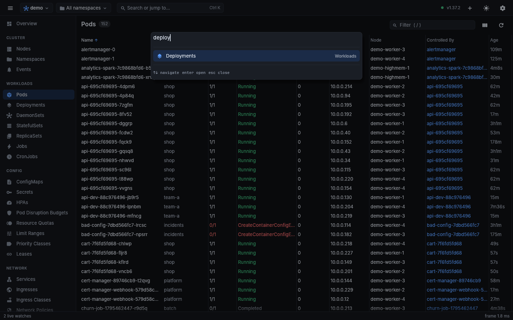

# Keyboard

Skiff's keyboard shortcuts. Press `?` in the app for this list with your
own bindings filled in. `Cmd` replaces `Ctrl` on a
Mac except where noted.

- [Everywhere](#everywhere)
- [Moving around](#moving-around)
- [Tables](#tables)
- [Details and YAML](#details-and-yaml)
- [Logs](#logs)
- [In a shell](#in-a-shell)
- [Changing the keys](#changing-the-keys)

## Everywhere

| Key | Action |
| --- | --- |
| `Ctrl+K` | Search or jump to anything (the command palette, below) |
| `Ctrl+,` | Settings |
| `?` | Keyboard shortcuts |
| `Ctrl+=` `Ctrl+-` | Zoom in, zoom out |
| `Ctrl+0` | Actual size |
| `Esc` | Close what is on top: a dialog, the details, the filter |

**The command palette** (`Ctrl+K`) finds resource types (kubectl's short
names work: `po`, `deploy`, `svc`), objects that are already loaded,
namespaces, clusters and actions such as "Reload kubeconfig", "Add
kubeconfig file…", "Check for updates" and making a cluster read-only.



## Moving around

| Key | Action |
| --- | --- |
| `j` `k` or `↓` `↑` | Next / previous row or sidebar entry |
| `Ctrl+d` `Ctrl+u` or `PageDown` `PageUp` | Down / up a page (`Ctrl` on a Mac too) |
| `g` `G` or `Home` `End` | First / last row |
| `h` or `←` | Move to the sidebar |
| `l` or `→` | Back to the table, or open the selected row |
| `Enter` | Open the selected row or sidebar entry |

## Tables

| Key | Action |
| --- | --- |
| `/` or `Ctrl+F` | Filter the table |
| `Esc` | Clear the filter |

`Ctrl+F` is for the table unless you are working in the dock: after a
click in a log tab it opens that tab's find box instead. If your
`keys.json` binds `Ctrl+F` to something, the table does that instead and
`/` remains the way to the filter.

Words in the filter match anywhere in a row. A word of the form
`column:text` looks in one column only: `node:worker-1`, `status:crash`,
`ns:kube`, `label:app=web`. The column title can be shortened to any
prefix. `column:=text` matches the whole value (`node:=worker-1` leaves
out `worker-10`), and a leading `!` keeps the rows that do not match
(`!status:running`). In front of a column filter `-` does the same
(`-ns:kube`); in front of a plain word it is part of the word, so `-prod`
finds `api-prod`.

Right-click a row for its actions. On a node or a namespace, "Show pods"
opens the pods table filtered to it.

Drag the edge of a column header to change its width; double-click the
edge for the default width. The widths and the columns you chose are
remembered; Settings → Appearance resets all of them.

## Details and YAML

| Key | Action |
| --- | --- |
| `]` `[` | Next / previous tab of the details |
| `Ctrl+S` | Apply the YAML you edited |
| `Esc` | Close the details |

## Logs

| Key | Action |
| --- | --- |
| `Ctrl+F` | Find in the log tab you are working in |
| `Enter` | In the find box: next match |
| `Shift+Enter` | In the find box: previous match |

## In a shell

Every key goes to the shell, including `Esc`, `Tab`, `Ctrl+K` and
`Ctrl+S`.

| Key | Action |
| --- | --- |
| `Ctrl+Shift+C` / `Ctrl+Shift+V` (also `Ctrl+V`) | Copy the selection / paste. On a Mac `Cmd+C` / `Cmd+V` |
| `Shift+PageUp` `Shift+PageDown` | Scroll back and forth |
| `Ctrl+Shift+F` | Find in the scrollback (`Cmd+F` on a Mac); `Enter` / `Shift+Enter` step through the matches, `Esc` closes it |
| `Ctrl+Shift+K` | Search or jump, from a shell (`Cmd+K` on a Mac) |

Click outside the terminal to give the keyboard back to the rest of the
app. Because `Ctrl+V` pastes, programs that use it themselves need their
other binding (in vim, `Ctrl+Q` starts a visual block). On Linux and
Windows the zoom shortcuts are not taken while a shell has the keyboard.

## Changing the keys

The keys for moving around can be changed. Skiff reads `keys.json` from
the same folder as [`config.json`](configuration.md#configjson) (or the
file named by `$SKIFF_KEYMAP`); Settings → Files opens it, writing the
defaults first if it does not exist.

The file maps actions to lists of keys. Actions it leaves out keep their
defaults, and `[]` unbinds one. For example, the Colemak home row with the
arrows kept:

```json
{
  "down": ["n", "ArrowDown"],
  "up": ["e", "ArrowUp"],
  "focus_left": ["h", "ArrowLeft"],
  "focus_right": ["i", "ArrowRight"]
}
```

| Action | Default | Does |
| --- | --- | --- |
| `down` | `j`, `ArrowDown` | Next row or sidebar entry |
| `up` | `k`, `ArrowUp` | Previous row or sidebar entry |
| `page_down` | `Ctrl+d`, `PageDown` | Down a page |
| `page_up` | `Ctrl+u`, `PageUp` | Up a page |
| `top` | `g`, `Home` | First row |
| `bottom` | `G`, `End` | Last row |
| `open` | `Enter` | Open the selected row or sidebar entry |
| `focus_left` | `h`, `ArrowLeft` | Move to the sidebar |
| `focus_right` | `l`, `ArrowRight` | Back to the table, or open the selected row |
| `next_tab` | `]` | Next tab |
| `prev_tab` | `[` | Previous tab |
| `filter` | `/` | Filter the table |
| `help` | `?` | Show keyboard shortcuts |

Keys are written as `j`, `ArrowDown`, `PageUp`, `Home`, `Enter`, `Space`,
`/`, `[`, `F5` and so on, optionally after modifiers joined with `+`:
`Ctrl+d`, `Shift+g`, `Alt+j` (or `Option+j`), `Cmd+j`. In this file `Cmd`
means the Command key on a Mac and `Ctrl` on Linux and Windows. A single
capital letter includes Shift: `G` is `Shift+g`. A key binds only with
exactly the modifiers given, so `j` does not also fire on `Ctrl+j`. If the
file has mistakes, Skiff says so and uses the parts it understood.

The other shortcuts on this page (the palette, Settings, zoom, `Ctrl+S`,
`Esc` and the shell's keys) are fixed.
