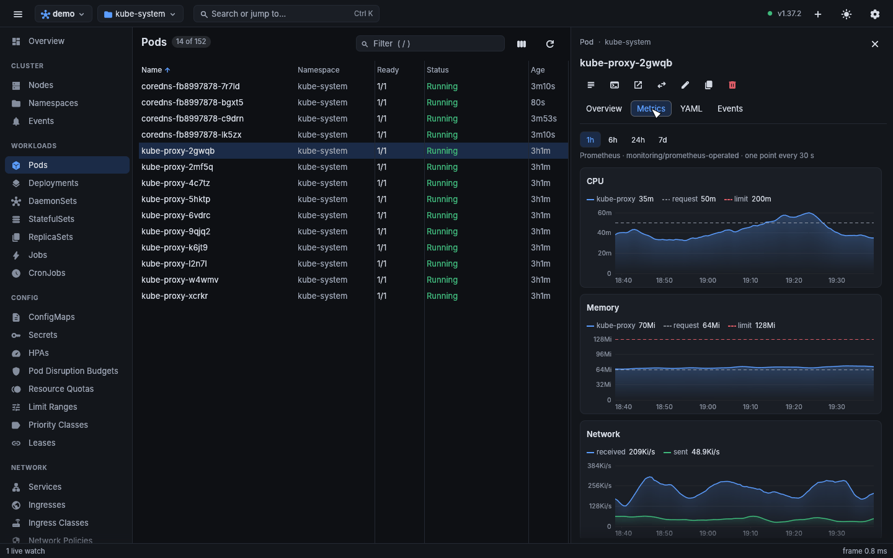
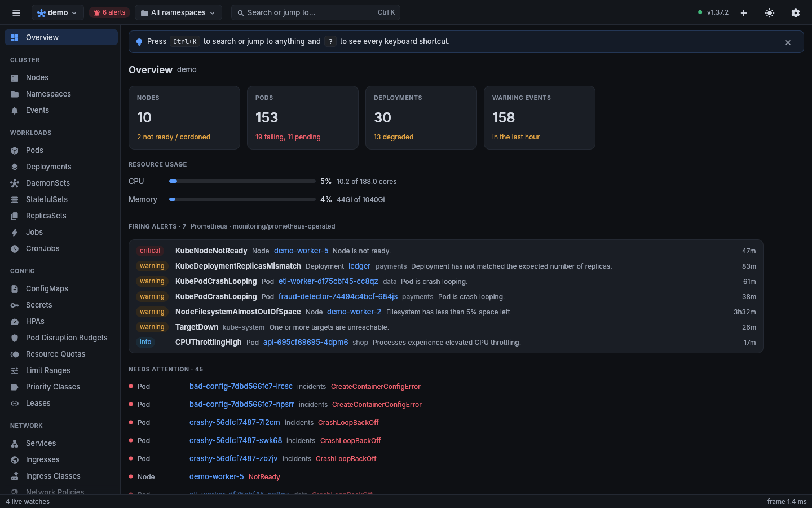

# Metrics, alerts and Grafana links

Skiff shows usage charts and firing alerts from the Prometheus that
already runs in your cluster. It reaches it through the Kubernetes API
server, with the cluster credentials it already has: there is nothing to
install, no second address to open, and no extra login to store.



- [The Metrics tab](#the-metrics-tab)
- [Firing alerts](#firing-alerts)
- [How Prometheus is found](#how-prometheus-is-found)
- [Telling Skiff where Prometheus is](#telling-skiff-where-prometheus-is)
- [The permission it needs](#the-permission-it-needs)
- [Without Prometheus: metrics-server](#without-prometheus-metrics-server)
- [Grafana links](#grafana-links)
- [Deliberately not there](#deliberately-not-there)

## The Metrics tab

Open a pod, a Deployment, StatefulSet, DaemonSet, ReplicaSet or Job, or a
node, and choose **Metrics**.

| Object | Charts |
| --- | --- |
| Pod | CPU and memory per container with the request and limit as dashed lines; network received and sent; restarts |
| Workload | The same, one line per pod (the first 100 pods of a large workload); the request and limit lines are those of a single pod |
| Node | CPU and memory against what the node can allocate; network of its pods |

- Time ranges: **1h, 6h, 24h, 7d**. The line under the buttons says where
  the data comes from and how far apart the points are (30 seconds for an
  hour, 2 hours for a week).
- Charts refresh on their own while the tab is open, every 30 seconds for
  the 1-hour range and less often for longer ones. Nothing is queried
  while no Metrics tab or overview is open.
- Hover a chart for the values at that moment. The legend shows the
  latest value of each line.
- A limit more than three times the usage is left off the scale so that
  the usage stays readable; it is still in the legend.
- At most 200 series are drawn per chart.

The charts are built from the usual metric names: cAdvisor's
`container_cpu_usage_seconds_total`, `container_memory_working_set_bytes`
and `container_network_{receive,transmit}_bytes_total`, and
kube-state-metrics' `kube_pod_container_resource_requests` / `_limits`,
`kube_pod_container_status_restarts_total` and
`kube_node_status_allocatable`. A chart whose metrics your Prometheus does
not collect says "No data in this time range". These queries have been
exercised against the project's test Prometheus, which imitates those
names; reports from real installations with other label conventions are
welcome.

## Firing alerts

With Prometheus found, Skiff reads its alerting rules' current state
(`/api/v1/alerts`) and shows the alerts that are **firing**:

- on the cluster overview, a **Firing alerts** list with severity, name,
  the object the alert is about (as a link), its summary and how long it
  has been firing;
- a count in the top bar;
- on an object's own panel, the alerts about that object.



An alert is tied to an object by its labels: `namespace` with
`deployment`, `statefulset`, `daemonset`, `job_name`,
`persistentvolumeclaim` or `pod`, or `node` (or the `instance` of a node
scrape job). The always-firing `Watchdog` alert and alerts with
`severity="none"` are left out, and at most 2,000 alerts are kept, the
most severe first. The list refreshes every 45 seconds while a view that
shows it is open.

Skiff only shows alerts. It does not acknowledge, silence or route them,
and it does not read Alertmanager, so an alert you silenced there still
shows here.

## How Prometheus is found

The first time a view needs it, Skiff lists the Services of the cluster
and looks for one that is Prometheus' query endpoint. Services in the
namespaces monitoring is usually installed in (`monitoring`, `prometheus`,
`observability`, `kube-prometheus-stack`, `victoria-metrics`,
`kube-system`, `default`) are preferred over look-alikes elsewhere; within
that, the order is:

1. the label `operated-prometheus=true` (prometheus-operator,
   kube-prometheus-stack);
2. `app.kubernetes.io/name=prometheus` (or `app=prometheus`) with
   component `server` (the community Prometheus chart);
3. VictoriaMetrics: `vmsingle`, or `vmselect` (queried under
   `/select/0/prometheus`);
4. a Service named `prometheus-server`, `prometheus-k8s`, `prometheus` or
   `prometheus-operated`;
5. a name ending in `-prometheus` or `-prometheus-server`, or the bare
   name label.

Alertmanager, exporters, the operator and similar Services are skipped.
Up to four candidates are asked a trivial query (`vector(1)`), and the
first that answers is used for the rest of the session. The source line on
the Metrics tab and above the alerts names it, for example
`Prometheus · monitoring/prometheus-operated`.

If your account may not list Services cluster-wide, Skiff looks in those
same namespaces and the ones you have selected.

When the search finds nothing, or finds a Service that does not answer,
the tab says which, and **Look for Prometheus again** repeats the search.
A Prometheus that is not answering is asked again after two minutes, and
then at growing intervals of up to half an hour.

## Telling Skiff where Prometheus is

If yours runs under a name the search does not recognise, or you want a
particular one, name it in [`config.json`](configuration.md#configjson).
With `namespace` and `service` set, nothing is searched:

```json
{
  "clusters": {
    "production": {
      "prometheus": {
        "namespace": "monitoring",
        "service": "prometheus-operated",
        "port": 9090,
        "scheme": "http",
        "path_prefix": ""
      }
    }
  }
}
```

`production` is the kubeconfig context name. `port` defaults to 9090 and
`scheme` to `http` (what Prometheus speaks inside the cluster, not how you
reach the API server). `path_prefix` is what comes before `/api/v1`: empty
for Prometheus, `/select/0/prometheus` for VictoriaMetrics' vmselect. This
must be a Service inside the cluster; a Prometheus outside it, or a hosted
one that needs its own credentials, cannot be used.

## The permission it needs

Every request is a GET to

```
/api/v1/namespaces/<namespace>/services/<scheme>:<service>:<port>/proxy/api/v1/...
```

on the API server, which forwards it to Prometheus. Your account
therefore needs **`get` on `services/proxy`** for that Service, and, for
the automatic search, `list` on `services`. Cluster administrators have
both. For anyone else:

```yaml
apiVersion: rbac.authorization.k8s.io/v1
kind: Role
metadata:
  name: skiff-prometheus
  namespace: monitoring
rules:
  - apiGroups: [""]
    resources: ["services/proxy"]
    resourceNames: ["http:prometheus-operated:9090"]   # <scheme>:<service>:<port>, as in the path above
    verbs: ["get"]
  - apiGroups: [""]
    resources: ["services"]
    verbs: ["list"]
---
apiVersion: rbac.authorization.k8s.io/v1
kind: RoleBinding
metadata:
  name: skiff-prometheus
  namespace: monitoring
subjects:
  - kind: Group
    name: developers
    apiGroup: rbac.authorization.k8s.io
roleRef:
  kind: Role
  name: skiff-prometheus
  apiGroup: rbac.authorization.k8s.io
```

Adjust the namespace, the Service name and port, and the subject. The
`resourceNames` line limits the rule to that one Service; the name has to
be written exactly as Skiff asks for it, scheme and port included (the
source line on the Metrics tab shows the Service, and the scheme and port
are the ones found or configured). Leave the line out to allow every
Service in the namespace. Whoever
has this rule can run any query against that Prometheus, which is what
the Prometheus web page would let them do too.

Without the permission the tab says "No access to Prometheus … Your
account needs "get" on services/proxy in its namespace", and Skiff stays
on metrics-server.

## Without Prometheus: metrics-server

Independently of Prometheus, Skiff reads metrics-server every 15 seconds
for the CPU and memory columns of the pod and node tables and for the
usage bars on the overview.

Where there is no Prometheus, the Metrics tab draws CPU and memory from
those samples, labelled "metrics-server · collected since you opened this
view": the history starts when you open the tab and is kept for as long
as you look, up to about an hour. Network and restart charts, and
anything further back, need Prometheus. With neither installed the tab
says so.

## Grafana links

Set the address of your Grafana for a cluster:

```json
{ "clusters": { "production": { "grafana_url": "https://grafana.example.com" } } }
```

The Metrics tab then has **Open in Grafana**, which opens Grafana's
Explore page in your browser with the CPU and memory queries of that
object and the same time range. Skiff does not talk to Grafana itself and
stores no login for it: you are signed in to Grafana in your browser or
you are not, and Grafana uses its default data source. The link format
(`/explore?schemaVersion=1&panes=…`) is the one of current Grafana
versions and has not been tried against every one.

## Deliberately not there

Each of these was considered and left out so that Skiff stays a small
program with no stored credentials and no web view:

- **Incident management** (PagerDuty, Opsgenie; acknowledging, escalating
  or silencing alerts). It needs stored tokens and stateful workflows.
- **Embedded Grafana dashboards.** They need a web view; Skiff links to
  Grafana instead.
- **A custom query box or dashboard builder.** Grafana's Explore, one
  click away, does this better.
- **Prometheus outside the cluster, or with its own login.** That means
  credentials Skiff would have to keep.
- **Log search across history** (Loki, Elasticsearch). Live logs are
  built in; history may come later.
- **A plugin system.** More code to trust in a tool that holds cluster
  credentials.
