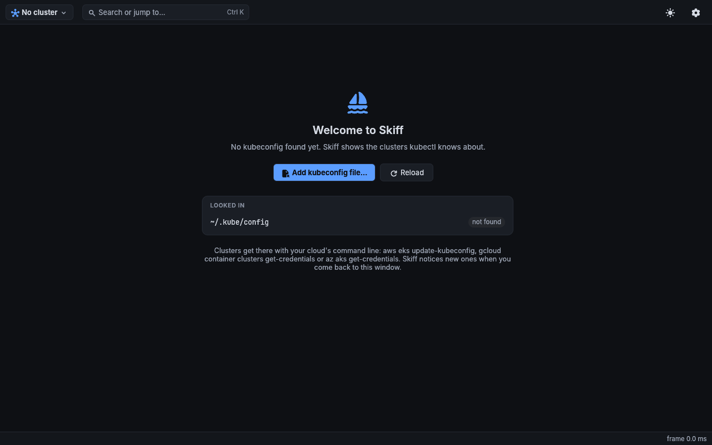

# Troubleshooting and FAQ

The problems people meet first, with what Skiff shows and what to do. If
yours is not here, [open an issue](https://github.com/TsenkoTsenkov/skiff/issues)
and paste what Settings → About → **Copy version info** gives you.

- [macOS says Skiff cannot be opened](#macos-says-skiff-cannot-be-opened)
- [Windows shows "Windows protected your PC"](#windows-shows-windows-protected-your-pc)
- [No clusters are shown](#no-clusters-are-shown)
- [Credential plugin was not found](#credential-plugin-was-not-found)
- [A cluster does not connect](#a-cluster-does-not-connect)
- [Prometheus is not detected](#prometheus-is-not-detected)
- [The window does not open, or drawing is broken](#the-window-does-not-open-or-drawing-is-broken)
- [A change is refused](#a-change-is-refused)
- [Updates](#updates)
- [Where Skiff keeps its files](#where-skiff-keeps-its-files)
- [Is there a log file?](#is-there-a-log-file)
- [Removing Skiff](#removing-skiff)

## macOS says Skiff cannot be opened

The Mac build is not yet signed with an Apple Developer ID and not
notarized, so macOS stops the first start. Allow it once: **System
Settings → Privacy & Security**, scroll down to the message about Skiff,
**Open Anyway**. From a terminal the same is:

```bash
xattr -dr com.apple.quarantine /Applications/Skiff.app
```

After that it opens normally. Check the download first if you like:
[install.md](install.md#checking-a-download). Each release's notes say
whether that build is signed and notarized; a notarized build needs none
of this.

## Windows shows "Windows protected your PC"

The Windows build is not yet signed, so SmartScreen warns about a program
it has not seen before. Choose **More info**, then **Run anyway**. The
installer writes only into your own user folder and does not ask for
administrator rights. To check the file first, see
[install.md](install.md#checking-a-download).

## No clusters are shown

Skiff lists the contexts of the kubeconfig files it reads. With none, the
welcome page says "No kubeconfig found yet" and names the places it
looked.



- **You have no kubeconfig yet.** Get one from your cluster: `aws eks
  update-kubeconfig`, `gcloud container clusters get-credentials`, `az aks
  get-credentials`, or the file your administrator gave you. Then switch
  back to Skiff; it reads the files again when its window gets the focus.
- **Your kubeconfig is somewhere else.** Choose **Add kubeconfig file…**
  on the welcome page, in the cluster menu or in Settings → Clusters, or
  drop the file onto the window.
- **`kubectl` sees the clusters in a terminal, Skiff does not.** Your
  shell sets `KUBECONFIG` in a file that a login shell does not read.
  Started from the Dock, the Finder or a desktop launcher, Skiff asks your
  login shell for `PATH`, `KUBECONFIG` and the proxy variables only.
  Start Skiff from that terminal to confirm, then either move the
  `export` to your login profile or add the files in Settings → Clusters.
- **A `kubeconfigs` list in `config.json` replaces kubectl's locations.**
  Once the list exists, only what it names is read. Settings → Clusters
  shows the list; "Use kubectl's locations" there goes back to
  `$KUBECONFIG` or `~/.kube/config` alone.
- **A file is broken.** A kubeconfig that cannot be parsed is listed by
  name with the reason in the cluster menu, on the welcome page and in
  Settings → Clusters. The other files still work.

The exact order of places is in
[configuration.md](configuration.md#which-kubeconfig-files-are-read).

## Credential plugin was not found

```
Credential plugin `gke-gcloud-auth-plugin` was not found
```

The kubeconfig entry for this cluster names a program that prints a
token (`aws`, `gke-gcloud-auth-plugin`, `kubelogin`, `kubectl-oidc_login`,
`tsh`, …), and Skiff could not find it on `PATH`.

1. Run `kubectl get ns` for the same context in a terminal. If that fails
   too, install the plugin; the table in
   [clusters.md](clusters.md#cloud-clusters-and-single-sign-on) says which
   one each cloud needs.
2. If it works in the terminal but not in Skiff, the terminal's `PATH`
   differs from the one a login shell gets. Start Skiff from that terminal
   to confirm (`skiff` on Linux, `/Applications/Skiff.app/Contents/MacOS/Skiff`
   on a Mac). The lasting fix
   is to set `PATH` in your login profile (`~/.zprofile`, `~/.profile`),
   or to write the plugin's full path into the `command` of the kubeconfig
   entry.
3. Choose **Retry** on the cluster's page.

A plugin that needs a variable such as `AWS_PROFILE` does not get it from
your shell profile: put it into the kubeconfig entry's `env` list
(`aws eks update-kubeconfig --profile <name>` does that).

## A cluster does not connect

The cluster's page shows what went wrong, a hint, **Retry** and **Copy
details**. Each message (expired login, 401, 403, DNS, certificate) and
what to do about it is in the table in
[clusters.md](clusters.md#troubleshooting-a-connection). Behind a proxy,
see [clusters.md](clusters.md#proxies); SOCKS proxies are not supported.

## Prometheus is not detected

The Metrics tab and the overview say where their data comes from. When
that line reads `metrics-server`, or the tab says "No Prometheus found in
this cluster", Skiff did not find a Prometheus Service it could query.

| What the tab says | Cause | What to do |
| --- | --- | --- |
| No Prometheus found in this cluster | No Service matched the names and labels of the common installations | Name yours in `config.json`, below |
| No access to Prometheus … Your account needs "get" on services/proxy in its namespace | Found, but the API server refused to forward the request | Ask for the Role in [observability.md](observability.md#the-permission-it-needs) |
| The service did not answer like Prometheus | The Service found is something else, or its port or path is not the query API | Set `port`, `scheme` and `path_prefix` in the override |
| No data in this time range | Prometheus answers, but does not collect that metric | Check that cAdvisor and kube-state-metrics are scraped |

Naming the Service skips the search:

```json
{
  "clusters": {
    "production": {
      "prometheus": { "namespace": "monitoring", "service": "prometheus-operated", "port": 9090 }
    }
  }
}
```

`production` is the kubeconfig context name. After a change, **Look for
Prometheus again** on the tab repeats the search. Only a Prometheus
*inside* the cluster can be used; one outside it, or a hosted one with its
own login, cannot. Details:
[observability.md](observability.md#how-prometheus-is-found).

## The window does not open, or drawing is broken

Skiff draws with the GPU: first with wgpu (Vulkan, Metal or DirectX,
whichever the system has), and if that renderer cannot start, with glow
(OpenGL). When both fail it prints, or on Windows shows in a
message box:

```
Skiff could not start: no graphics driver on this machine can draw its window.
```

followed by what each renderer reported.

- **Force one renderer** with the environment variable `SKIFF_RENDERER`:

  ```bash
  SKIFF_RENDERER=glow skiff      # OpenGL only
  SKIFF_RENDERER=wgpu skiff      # wgpu only
  ```

  On Windows: `set SKIFF_RENDERER=glow` in `cmd`, or
  `$env:SKIFF_RENDERER = "glow"` in PowerShell, then start `skiff.exe`
  from that window. Try `glow` when the window opens but is black,
  flickers or shows garbage.
- **A Linux machine without a GPU driver** (a VM, a remote desktop) needs
  a software one: `mesa-vulkan-drivers` on Debian and Ubuntu. Skiff then
  works, drawn by the CPU.
- **"Skiff could not open its window"** is not about the renderer, and
  the other one is not tried: usually there is no display to open a
  window on (over SSH, for example, with neither `DISPLAY` nor
  `WAYLAND_DISPLAY` set).

## A change is refused

- **Actions are greyed out and a lock shows in the top bar.** The cluster
  is marked read-only in Skiff. Turn it off in the cluster menu under
  **Protection**, in Settings → Clusters, or with "Allow changes to …" in
  the palette. See [clusters.md](clusters.md#read-only-clusters).
- **Every cluster became read-only at once.** `config.json` is not valid
  JSON. Skiff cannot know which clusters you protected, so it protects all
  of them until the file is fixed. The notice names the problem; Settings
  → Files opens the file.
- **403, "does not have permission".** The cluster refused, not Skiff:
  your account's RBAC does not allow the action.

## Updates

- **macOS says "Move Skiff to Applications to enable updates".** The app
  is still running from the disk image or the Downloads folder, a place
  macOS makes read-only. Drag it to Applications and open it from there.
- **Windows and Linux never update by themselves.** The **New version**
  button opens the release page; install the download over the old one.
- **Turning the check off:** Settings → Updates, or
  `SKIFF_NO_UPDATE_CHECK=1`.

## Where Skiff keeps its files

| What | Linux | macOS | Windows |
| --- | --- | --- | --- |
| Settings, `config.json` | `~/.config/skiff/` | `~/.config/skiff/` | `%APPDATA%\skiff\` |
| Key bindings, `keys.json` | next to `config.json` | next to `config.json` | next to `config.json` |
| Window state, `app.ron` | `~/.local/share/skiff/` | `~/Library/Application Support/skiff/` | `%APPDATA%\skiff\data\` |
| Update log | none | `~/Library/Logs/Skiff-update.log` | none |

`$XDG_CONFIG_HOME` moves the first folder on Linux and macOS, and
`$XDG_DATA_HOME` the window state on Linux. `$SKIFF_CONFIG` and
`$SKIFF_KEYMAP` name the two files directly. Settings → Files shows the
paths in use and opens the files. None of them holds a credential: Skiff
reads your kubeconfig where it is and never writes to it.

Window state is pane sizes, the last view and the namespaces selected per
cluster. Deleting `app.ron` while Skiff is closed resets those and
nothing else.

## Is there a log file?

No. Skiff keeps no log of what you do. The one file it writes besides
those above is the macOS updater's record of a swap,
`~/Library/Logs/Skiff-update.log`.

Problems are shown in the window: as a notice, on the cluster's page
(with **Copy details**), or on the tab concerned. A few start-up messages
go to standard error, so starting Skiff from a terminal shows them:

```bash
skiff                                              # Linux
/Applications/Skiff.app/Contents/MacOS/Skiff       # macOS
```

These are a renderer that did not start, an unknown `SKIFF_RENDERER`
value and a mistake in the command-line options. `SKIFF_TRACE_STARTUP=1`
adds the start-up timings.

## Removing Skiff

- **macOS:** move Skiff from Applications to the Bin.
- **Windows:** Settings → Apps → Skiff → Uninstall; for the portable zip,
  delete the folder.
- **Linux:** `sudo apt remove skiff`, or delete the AppImage, or delete
  the files the archive put under `~/.local`.

Then delete the folders in the table above if you want the settings gone
too. Your kubeconfig is not touched.
